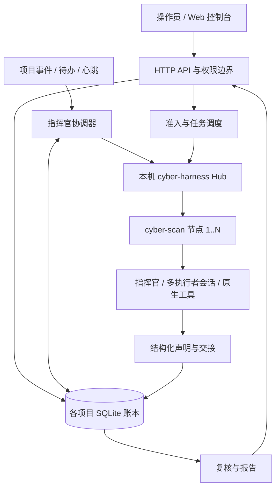
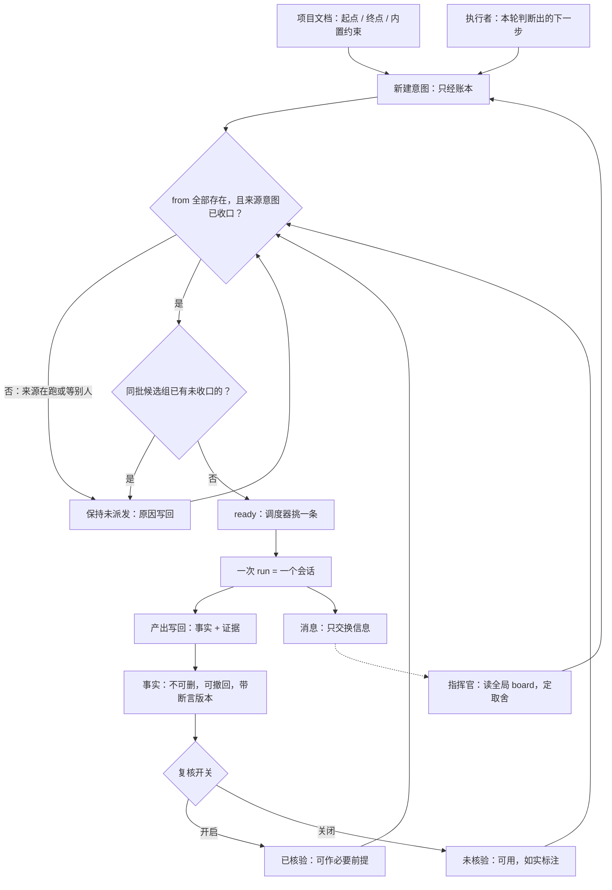

# 天吴核心架构

本文描述当前实现的职责与边界。安装、启动和操作入口见 [README](../README.md)，代码变更遵循[设计取向](../agent.md)。

## 0. 设计取舍

本节只写判断，机制细节在后文。

**状态不进模型上下文。** 会话会压缩、会丢、会被模型改写，长提示词和会话记忆都无法复核；把全局状态放进账本与图谱，任何结论才都能回到带版本的记录和原始证据，换进程、换会话、换执行者都不改变判定。

**复核独立于发起方。** 产出断言的人同时判定断言就是自证；「消息送达」只证明传输完成，「运行结束」只证明进程退出，都不证明断言成立，所以结论只能由独立复核者对证据重跑后给出。

**禁静默重试**：失败必须看得见，自动重试会把确定性失败伪装成偶发，并对外部动作重复施加副作用；**禁默认值兜底**：用看起来合理的值填未知，会把「没有数据」读成「正常」，错误和缺失从此不可观察；**禁从日志/摘要生成事实**：日志是不可信数据、摘要是模型转述，拿它们生成断言就绕过证据链，等于伪造已核验结论。

**红队能力优先。** 契约、账本、校验、审批都是支撑手段，不是目的；每加一层必须能说出它换来哪条具体红队能力——可复现的打击、可复核的证据、可交付的报告。“看起来更严”不算能力，说不出来就是做重。

**单用户、单实例、多项目。** 单进程才能让账本、锁和调度只有一个真相，多项目让每个 engagement 的授权与证据互不串味；控制面只记录与判定，不内置攻击步骤。项目之间靠目录与账本隔离；进程隔离、网络隔离与节点级可见性都没有实现，不宣称。

**只记录，不替人做取舍。** 只记 token，不设费用闸门；外部动作只记录状态与结果，不自动重放；人工审批是账本里的一条记录，不是安全边界，不宣称它挡得住攻击。打到什么程度由执行者与指挥官判断，控制面不设阈值替他们决定。

**能力来自涌现，不是预置剧本。** 模型加证据与复核约束才产生可用能力，剧本的代价是模型只会复制，遇到剧本外的情况就停。要写的只有会改变结果、且失败不留痕的事实——例如「本轮 POC 库是哪个目录」必须让模型知道，否则它只能拿到错误结果且没人知道为什么；但命令行形态与 `-t` 这类参数默认语义归 harness 的工具描述承载，天吴提示词只写本轮指派、不复述一遍，harness 描述缺这条就改 harness，不在下游各补一遍；流程剧本（先信息收集、再打点、再提权）一律不写，顺序由模型自己决定，平台只校验它交出的证据。判据一句话：这条信息是不是「不写就会静默失败」的事实，是就写，不是就别写。账本里的打法也不是预置教材：它由执行者在运行中自己总结、经复核后落库，退役与降级同样由证据决定，这是「涌现」的可核查形态。

**与论文的关系：** 图谱这条主线是本项目的主体，控制面只提供环境与判定，不写剧本。

## 1. 系统边界

天吴是单实例、单用户、多项目的授权安全测试平台，支持同一个原生 Hub 上的多个 scan 节点。`tw` 在一个进程内提供 HTTP API、Web 控制台、项目账本、调度与指挥官协调；独立构建的 cyber-harness fork 分为 Hub 与 cyber-scan：Hub 管理连接、模型配置和 AOP/IOA，scan 承载模型会话、工具、原生命令、Skill 发现和上下文压缩。HTTP 入口有请求头、读、写和空闲超时，并对请求体设上限：普通请求 16 MiB，唯一例外是 `/api/projects/import` 的项目包上传（4 GiB，且只在该路由、非 JSON 请求体时放宽；文件直接落到临时文件，不进入内存）。两者都先按声明的 Content-Length 拒绝，分块上传在越界读取时失败，避免慢客户端或无界 JSON 把一个 handler 变成资源出口。

天吴决定何时允许新一轮模型调用，记录任务及证据；模型决定测试策略和分工。控制面不内置固定攻击流程，不从运行日志推断漏洞，也不复制 harness 的工具、会话或压缩实现。

### 1.1 事实与意图的运行模型

这张图是调度的判据：意图只等前提，不等命令。

**事实不可变。** 事实只能新增、更正、撤回，不能删除；撤回绑定当前断言版本并保留全部历史（`internal/store/store.go:571`、`internal/api/fact_withdraw.go:62`）。断言版本与指纹由 `claimHash` 计算（`internal/store/claim.go:31`），只有断言内容变化才递增（`internal/store/store.go:504-505`）；复核绑定断言版本，不随簿记字段漂移。

**意图等前提。** 意图的 `from` 是必要前提（`internal/model/model.go:219`），`to` 是这一轮要产出的未来，完成时以 `done_fact_ids` 写回（`internal/model/model.go:334`），本轮产出仍以事实与证据入账。派发时冻结 from 的版本快照（`internal/store/input.go:85-158`）；from 必须存在，且**来源意图已收口**才算成立（`internal/store/input.go:102-104`、`PremiseOwnerStillLive` `:182`）。来源在跑或等别人时不算；两条例外分开算：其一是来源正在等我（`internal/store/input.go:208-215`），其二是本意图引用自己更早 run 产出的事实（`:183-187`）。复核开启时另加当前断言的独立核验要求；关闭时只放过「未核验且可复核」这一类，withdrawn、rejected 与不能作为必要前提的类别（如 note）仍然挡，且只记一条 gap、不当作已核验（`internal/store/input.go:105-137`、`internal/model/premise.go:33-55`）。

**ready 调度。** 实际语义是「被派发且 ready 才跑」，不是「待办就自己跑」：顶层 pending 意图不会自动启动，要由指挥官显式发起（`internal/api/collab.go:398-401`）；子意图与唤醒由 `pump` 统一接管（`internal/api/collab.go:379-490`）。两条路进同一个准入（`internal/lifecycle/lifecycle.go:509-587`：暂停、容量、前提、候选组、父子同跑与状态，最后一次性认领）。

**一个 run 一个会话。** 同一意图同一时刻只有一个 run 持有会话：认领意图与写 run 行在同一事务里完成（`internal/store/admission.go:12-52`），认领本身是唯一并发闸（`internal/store/store.go:250-275`）。会话 marker 记在意图自己的 case 下（`internal/aopexec/executor.go:231`）；`continue` 与 retry 的 resume 是显式复用同一会话（`internal/api/continue.go:119`、`internal/api/api.go:1952`），会话丢失才按账本重建。

**产出以事实加证据写回。** 运行中的声明经 `ApplyDeclaration` 入账（`internal/ledger/apply.go:47`），收口时原件保全为证据行（`internal/ledger/ingest.go:353`）；只有账本里带摘要的原件才算可复核。

**消息只交换信息。** 协作消息是账本对象（`internal/store/message.go:156`），用于通知、追问与请求人工访问；它不创建意图、不改变授权。

**创建只走账本。** 顶层意图经 `POST /api/intents`（`internal/api/api.go:809`）落账，执行者的子意图与平级意图经 spawn（`internal/api/workers.go:130`、`internal/store/spawn.go:46`）落账；账本外没有第二条创建路径，调度只认账本行。

**递归与平级。** 子意图运行中可再派，没有层级语义限制；平级发布不挂 `ParentID`，创建出来就是独立并行意图（`internal/store/spawn.go:46-110`）。扩张受谱系预算约束（每 run 上限、单谱系上限、执行者发起的深度上限；常量在 `internal/store/lineage.go:41-52`），超限是拒绝并说明，不排队、不吞掉。

**候选组。** 同一决策的备选带 `candidate_group`（`internal/model/model.go:260`）；派发闸同组一次只放一条，占用判据是「已开始且未收口」：claimed、running、waiting、复核未收口的 reviewing 都算（waiting 的 run 虽结束，子树还在跑、它还会被唤醒；放另一条出去就是同批两条在飞），还没开跑的 pending 不算——否则同组两条 pending 会互相挡住（`internal/lifecycle/lifecycle.go:556-560`、`internal/store/collab.go:122-141`）。其余保持未派发并给出原因；选哪条、弃哪条由指挥官判断，平台不自动弃。

**指挥官。** 读全局 board 定优先级、停止与裁决重复，但不垄断创建（执行者也能写下一步）；子意图失败与成功一样唤醒父意图，平台不替父意图重试（`internal/api/collab.go:674-699`）。

## 2. 角色与执行契约

操作员定义项目文档的三份内容——起点（资产与背景）、终点、内置约束——以及测试时段和禁止动作，决定启动、暂停及人工授权。指挥官可以请求停止整个项目（持久暂停，只由操作员恢复），但不能启动或恢复项目；终点定义的默认写者是操作员，唯一的例外是活着的指挥官轮次引用操作员发给指挥官的明确消息（`operator_message_id`）代改，拒绝逻辑在 `internal/api/goal_edit.go:17`（要求指挥官身份、在跑 run、消息由操作员发给指挥官且非空），引用冻结在目标上；执行者不能停整个项目，只能把判断交回指挥官。可编辑的内置约束文档只表达这些边界，例如禁止删改目标业务数据；它不承担通用角色提示词的职责。新建项目顶部有「红队」与「日常渗透」两个场景按钮（`web/src/lib/project-scenarios.ts`）：点一下只把对应预设的**起点与终点**填进表单，不写内置约束、不改授权范围、不改暂停语义；代码里没有「场景」这个概念，某个场景不再需要就是删掉那条记录。

指挥官在 harness 长会话内读取项目目标与状态，组织意图、派发和协作、处理待办并判断是否完成。内置 commander Skill 规定证据标准、版本意识和职责。执行者只取得内置约束原文、本轮指派、控制面才知道的运行事实、账本里已核验的决策材料与证据交接契约；不接收起点与终点文档，也不接收内部评测备注。执行者提示词以第三方「任务来源」段标明该意图由指挥官、操作员或同僚执行者发起，不写第一人称权限句；参考事实按 note（永不复核的线索）、已撤回、已否定、未核验待复核、状态未知分别标识；复核开启时，只有当前断言已独立核验的事实能作为必要前提；提示词不解释这些材料各自是什么，只给原文。意图文本里的具体路线是派发者的起点，不是完成条件：执行者在已收到的约束与指派范围内自主选择方法，一条打法失败不等于意图不可达，完成与否以验收标准为准；没有单独验收标准时由执行者按意图标题形成可复核的完成判据。指挥官派发时，意图标题写交给执行者的下一步动作，验收标准写怎样判断这一步完成，具体打法留给执行者；执行者任务书只保留战场读取入口，命令细节在 `collaborate` skill；普通局部推进由执行者判断、不必逐步请示；跨意图取舍由指挥官掌握。任务书不写停手条款：停手线与允许手段只来自三份项目文档原文与操作员指令。

看门狗负责确定性的存活检测、失联运行取消和状态对账，并保留等待关系及中断原因。复核器与报告器分别承担断言核验和结果整理。执行者以意图及其运行为身份和状态来源；操作员界面提供观察、停止、连接状态与消息权限管理。

组织围绕可验收意图临时形成，不扩展固定军衔、人格繁衍或生存机制，不为维持组织另设角色状态。指挥官处理全局取舍，执行者承担具体意图，看门狗保持确定性，独立复核保留自己的证据与结算边界。指挥官、执行者、复核与报告使用同一模型网关连接，分工不依赖模型档位。

发起者归属只记录出处：意图的 `created_by` 是创建它的 participant（指挥官、操作员或执行者），`delegated_by_run` 是创建它的运行；两者都不是权限，也不表示上下级。执行者可以发布不挂父意图的平级意图：控制面从发起意图继承约束文档（Doc）与节点、技能取并集，但平级意图不是它的子意图，双方同层协作、各自对结论负责，发起者不等结果（结果以共享事实与机械通知交回）。平级发布必须引用至少一条已记录事实（`from`/`context`/`pinned` 任一），零依据的 bootstrap 只由指挥官或操作员发起；节点必须与发起意图相同（同 ID 放行，不同 ID 拒绝）。真正的层级只有 ParentID 与 Wait：挂父意图并可被等待的意图对外称“委托（等待）”，父意图让出执行槽，在子意图结算或超时后续跑。执行者发起谱系有预算：每个 run 最多发起 8 个意图（平级发布与委托都算）、单条谱系最多 64 个意图、执行者发起深度最多 6 层；超限时先合并、收口或交回指挥官，不得换幂等键重试。

每条结论必须关联可复核的原始证据。无法保留证据的内容只登记为线索，不能表述为已验证结论；是否复核及复核哪一版断言由账本决定。目标输出、文件和网页内容属于待分析数据，不构成操作员授权。复核器按验收标准检查证据，报告引用账本中的当前记录。「可复核」是机器可判的谓词，不是「登记过原件」的同义词：证据行的摘要折小写后必须是 64 位 SHA-256 hex，空摘要、长度不对、非 hex 都不算可复核（`internal/store/evidence_meta.go:20`、`:24`、`:55`）。展示层、readiness 与派发前的记录共用这一个谓词（`internal/api/graph.go:217`、`internal/api/readiness.go:146`、`internal/store/input.go`），三处不再各写一份「摘要非空」或「id 在不在」；原件不合格时派发照走、只记一条说明（第 4 节）；写入口也按同一规则拒收非法摘要，以及指向保全副本却没有摘要、摘要与副本名不一致的行（`internal/store/evidence_meta.go:24-32`）。

前提准入只有 `verified_only` 一种，但它只在一个意图上有闸：**复核开启时**，必要前提须当前断言已独立核验、且登记的每个原件都带 SHA-256 摘要，否则这次派发被拒并给出原因；**复核关闭时**没有判定会到达，未核验事实按可用前提使用、状态如实标 unverified，只有 `withdrawn`/`rejected` 与复核永不可建立的 kind 仍挡（`internal/store/input.go` 的 `DispatchGate`，调用点在 `internal/api/api.go` 的 `dispatch`）。原件缺摘要或不在账本里不属于判定，它在两种模式下都只记一条 `dispatch_gap`（哪个意图、缺什么）到 run 的板面与 journal，不阻断派发——证据链不完整本身说明不了什么，不能拿它当闸。旧清单里的 `standard` / `strict` 在加载时一次性迁移为 `verified_only` 并写回清单；不存在标准模式的只读兼容路径，也不再接受 `standard` 写入。这个模式是常量而不是设置：项目设置接口与前提政策接口都不提供写入，只有读取，因为清单在加载时已被规整成唯一值，任何"保存"都只能把当前值再写一遍，却看起来像一次操作员决定。

## 3. 持久数据模型

名称固定为：**意图**是指挥官或执行者决定下一步交给执行者做的事（实体 `intent`，表、字段与 API 路径沿用 `intent` / `/api/intents`）；**图谱**是意图与事实的关系图（早先叫「事实意图图」，不再作为正式名称使用）；**任务**只指 harness 的一次工具调用，不指业务实体。

这张表的分工（唯一一处细节，代码、提示词与文档都按这里）：

| 词 | 含义 | 标识符 |
| --- | --- | --- |
| 意图 | 下一步交给执行者做的事，账本对象 | `intent` |
| 事实 | 观察与结论，账本对象 | `fact` |
| 线索 | 未核验的事实或 `note`，是状态描述，不是对象名；`state.md` 的「待验证线索」一节按这个用 | 无（`note` 是事实的一种 kind） |
| 方向 | 只用于表示方向键或几何方向，不作实体名 | 无 |
| 任务书 | 本轮给执行者的简报（约束原文 + 本轮指派），是文件与提示词的说法，不是账本对象 | 无 |

各项目位于 `<data>/projects/<id>`，使用 `ledger.sqlite` 作为事务状态来源，工作目录、原始证据和会话材料与账本分开保存。目录 `<id>` 是短随机标识（`p-xxxxxxxx`），与项目显示名解耦：改名不移动目录，名称/简报里的目标域名也不会进入路径或控制台 URL。当前版本要求匹配的 SQLite schema；不在启动时自动导入旧 JSON 数据。

普通意图写入与按运行状态匹配的条件写入共用依赖环校验。事实通过 `UpdateFact` 失去已核验状态时也会撤销下游背书，版本日志记录 `premise_lost`，状态变更保留原断言版本。失效传播在锁内建立临时依赖索引，先撤销整条链上的背书，再根据更新后的前提状态统一推导标签。

账本提交成功后才发布行、索引、读取版本和版本历史。提交失败时，从内存中的上一次提交恢复工作状态，即使 SQLite 此时无法读取，也不会把失败事务带到后续读取。历史有效置信度可在项目暂停且 `tw` 停止后用 `tw-repair --project <绝对目录> --confidence` 预览。加 `--commit` 会先备份账本，再按预览版本写回能保留断言哈希的派生标签。

项目清单中单项设置的保存失败时，内存保留原值，后续保存也不会带入这次失败的修改。授权简报与项目运行设置通过受锁保护的运行时快照读取，避免设置更新与派发、指挥官开轮发生数据竞争。

项目整体迁移使用 `.twproj` 包：导出只在项目暂停且没有在跑运行时进行，账本通过 SQLite 快照写入，避免只拷主文件而漏掉 WAL 中已提交的事务；包内每个文件带 SHA-256。导入先完整校验条目的路径、大小和摘要，再把账本以只读方式打开并复核每条证据的登记摘要，最后才把暂存目录改名为 `<data>/projects/<id>`，因此被拒绝的包不会留下半个项目。运行的会话标记、`.tw` 下的按会话令牌与 `.tw/media` 媒体原件、`commander/` 临时工作区、`.verify` 草稿以及 `.access` 的租约和控制会话不随包迁移；意图工作区内的 `worker-note.md`、原始 `facts.jsonl`、消费游标 `facts.offset` 和显式游标修复记录作为持久材料保留，按会话凭据与 AOP marker 仍排除。旧导出包可能没有声明文件，不能据此推造历史游标。导入项目固定以暂停状态落地，且目标版本必须与包内账本 schema 一致；没有跨 schema 的导入迁移路径。包的 `manifest.json` 另记两条**实例态**：`runtime.review_enabled`（导出那一刻的复核开关，来自运行时开关而非启动参数）与 `runtime.review_boot_disabled`（实例是否以 `--no-verify` 启动）；两条都不改写项目策略——`project.json` 的 `premise_policy` 只有 `verified_only` 一个合法值，它描述项目要求，不描述这次运行的实例状态。旧包没有 `runtime` 字段时按「未知」读，不能当成「复核开过」。

| 对象 | 职责 |
| --- | --- |
| Goal / Intent | 项目目标、可验收的工作意图、前提、依赖与状态 |
| Fact / Evidence | 显式声明、有限派生、原始材料与断言版本 |
| Run | 一次有账本记录的执行，含模型、状态、用量及停止原因 |
| Review | 绑定具体断言版本的复核结果 |
| Instruction / Context | 持久指令、引用、固定项及上下文选择 |
| Message / Delivery | 协作消息、状态变化交付及确认 |
| Notebook / NoteRef | 私有判断笔记、历史正文、事实版本引用，以及绑定写入者和指挥官运行轮次的摘要回执 |
| Access / Action | 人工访问前提、外部动作状态、幂等身份及未知结果 |

记录版本用于并发更新检查；断言版本用于判断既有复核是否仍适用。修改断言不会把旧复核自动带到新版本。来源日志和观察事件不会自动晋升为发现。图关系表达依赖、引用和固定上下文，不能把“存在一条边”解释为其内容已被证明。

事实可以撤回，但不能删除。撤回是绑定当前断言版本的状态（`withdrawn`）加一条必填理由，由声明它的意图在未复核时发起，或由操作员对任意事实发起；指挥官不能撤回执行者的事实，已核验或已否决的事实也只有操作员能撤回。撤回保留事实、证据与全部历史，但该断言不再能作为必要前提、目标依据、交接引用或报告结论，工作板与任务书不再把它当作项目知识；之后的重声明是新断言版本，不继承撤回。撤回与复核否决是两件事：后者说明证据不成立，前者说明这条记录本来就不该留。

打法（playbook）的 `status` 只是写者的声明，不是判定：执行者声明照原样落库（含零来源），确认标签在每次读取时按来源重新判定——来源非空、全部已核验、带原始证据、未撤回或未否决，才按「确认」展示、召回和计数；任一来源不满足即按「候选·未验证」处理，不删行、不隐藏、不落库、不迁移。因此撤回来源事实会通过读取传导到打法，之后复核通过也会自动恢复确认，不写回也不改存储的声明。

项目的终点目标由操作员定义；项目在所有有效目标达成且无在办工作时收口。创建项目时写起点与终点（起点进入项目简报，终点是可判真假的最终状态），追加目标也只能由操作员显式操作；两者都是操作员的自然语言，控制面不做量化评分。执行者不改写目标。当前指挥官不自行创建、改写或关闭目标：create/update/close 三个入口共用同一条校验（`internal/api/goal_edit.go:17`），操作员直接执行，活着的指挥官轮次只能引用操作员发给它的明确消息代为执行，引用冻结为目标上的 `InstructionRef`，账本同时记发起 run。每次改写都写 `updated_by`：操作员会话记 `operator`，代做的指挥官轮次记那条 run id；作者为空时 `internal/store/document.go:104`、`:170` 直接报「文档保存必须记录修改人」，不静默落成 `operator`。控制面证明写者身份，不对自由文本做语义判断。编辑定义会撤回旧达成收据，历史版本保留；`closed` 表示撤回而非达成，关闭目标不进入开放目标和完成门禁，全部关闭也不等于项目成功。`/met` 仍只允许操作员。复核关闭时，`complete` 与 `met` 不再要求每条依据都有当前核验收据——没有判定会到达，要求它只会让目标永远盖不了章；事实存在、未撤回/否定、有证据行这几条仍然检查，操作员手工盖章也可以不引用 from。复核开启时维持原规则。未达成终点不画进链路、也不连线，只在图谱左下「终点」卡显示；达成后接到承载证据的事实上。

## 4. 运行生命周期与准入

执行者从意图派发为 Run，取得当时的前提与上下文。运行中的声明经 API 写入账本，结束时提交结构化交接。等待子意图时按协作协议让出槽位，依赖就绪后由调度器续接；取消与停止原因保留为显式状态。

项目暂停、宿主就绪、项目及实例并发容量和前提状态共同决定是否允许新调用（前提状态只在复核开启时参与；复核关闭时只有 `withdrawn`/`rejected` 挡，见第 3 节）。原生闲置消息留在邮箱，只有经过天吴准入并记录的续轮才能开启模型调用，避免账本外自动续跑。恢复按“有事可做”判定：项目已收口且没有未达成目标、待办意图或未读操作员消息时，显式的「继续项目」保留暂停并说明原因，不开一轮只看已收口 board 的指挥官轮次；操作员消息都能开轮；**追加目标只对可归类的暂停顺便清掉暂停**——`internal/api/goal_continue.go` 的可恢复集合含三类有原因的暂停与 `restart_pause`（机器停的、不含停止意图，所以不必让操作员的“追加目标”再被一次重启挡回去），不含 `unrecorded`（数据看不出当时是谁停的，可能正是指挥官的主动停止，自动继续等于覆盖一个看不见的决定）：后者只追加目标、项目仍暂停并提示「暂停原因未记录」，要继续得显式点「继续项目」；消息驱动的补测轮会在提示词里标明不得改动目标。

这套判定只有一个实现，控制台和写入路径共用：操作员 board 返回 `project_actions`，含暂停、继续、追加目标三个动作的可用性与原因码（及其判定所用的计数：目标达成/未达成/已撤回、待办意图、未读消息、收口中），「继续」按钮与该判定同时决定恢复请求是否被拒，前端不再用暂停状态加目标数量自行推导“已收口”。“目标已全部达成”和“仍有待办意图”可以同时成立，两者必须一起说明，不能用一个状态词盖掉另一个。动作契约只给操作员 board，会话面看不到派发决策。

进程重启后项目默认保持暂停，操作员检查现场后恢复。意图状态、事实和交付有持久记录；部分指挥官会话周期信息及暂停说明仍依赖进程内状态，不能视为完整的分布式恢复协议。

## 5. 长会话与状态检索

指挥官保留长会话以接续推理，账本作为外部持久记忆。默认保持长会话；一个压力周期以有效交接回执收口后自动轮换到新的指挥官会话（内置行为，无开关）：交接轮通常不派新意图、只重写笔记，紧随的下一轮从笔记、board 与当前约束重新开始，避免长会话在 85%–100% 区间持续按整段上下文计费；记忆载体始终是笔记与账本，不是会话本身。概览只提供必要索引，正文、历史、证据和意图子图按需读取；冻结快照通过游标分页，避免跨页读到不同版本。控制台图谱固定在一份完整快照上：默认每 6 秒探测账本变化并自动换入新快照（可关闭实时刷新），刷新只整体切换快照，不跨版本拼接页面；一次打开就把该快照的全部页读完（没有“加载更多”），换快照时整体替换，相机位置保留，未达成终点不上图（左下终点卡），达成后接到承载证据的事实上。图谱按账本状态着色：未满足的硬门槛（前提事实未核验、不可复核或缺失）是虚线红，实线红只表示正在执行。意图还没有产出事实时，链路末端是幽灵环：它是“尚未产出”的占位，不是可打开的节点——点击它不选中、不展开右侧面板（列表视图同样不列出），悬挂详情只由步骤节点承担；双击画布也不移动或缩放相机，适配画布只由工具栏按钮显式触发。选中即焦点：选中节点时，画布按一条链路分三层——主干（`mainPath` 顺序，节点带 1、2、3… 编号、边加粗）满亮，主干节点的一跳旁支次亮，其余节点压暗但仍绘制，图上不隐藏节点。右侧面板展示选中节点的详情，面板顶部提供「只看这棵树」与「看全图」。悬停与点选共用这一份集合（`graph/chain.ts` 的 `chainView`），悬停不夺取已经建立的选中焦点；悬停预览默认关闭，工具栏的“悬停预览”开关打开后才出现悬停卡片（力导向与链路树共用同一个开关）。选中一条关系（蓝色必要前提与意图产出事实线是同等地位）时只点亮它连接的两个端点，同一步骤的其他前提或别的产出线一并淡化。力导向按账本原样绘制全部边，链路树全量显示、不截断、不分页。收窄显示只有一个显式动作「只看这棵树」：按钮打开后只画该节点的全部祖先（从简报起点逐跳下来）、它自己以及它往下两跳的产物，集合外的节点与边都不画；按「看全图」或改选中节点即恢复全量，默认始终是全图。过滤未设置或集合为空都按未设置处理，不会清空画布。右侧的节点面板、通信入口和悬停卡片共用一条可拖动的宽度，拖左缘或按方向键调整并持久化。图谱固定为“状态色第一通道 + 发起者第二通道”：发起者只读 `created_by_participant_id`（`commander`/`operator`/`pt_<意图>`；旧数据不画），用形状区分（实心菱形/双环/空心圆）。无 `parent_intent_id` 的执行者意图由 `created_by`（必要时 `delegated_by_run_id` 对应的 run 兜底）派生一条低透明度 1px 虚线、开口箭头的“发起边”；来源无法从本快照解析时不画、不猜。发起边只用于绘制、命中与选中/悬停高亮整条发起谱系，不计 degree、不参与结构深度、分层与力导。助手层是图谱上的卫星而不是节点：步骤 pill 右上角按该意图最近一次执行 run 的 `native_subagent_*` 聚合显示最多 3 颗卫星点与“助×N”，活跃时慢脉冲；助手不参与布局、不可单独选中、不产生连线。

每次快照读取按游标逐页读到 `has_more=false` 才写回数据，同一时刻只有一次读取；被新快照替代的旧请求不能回写数据或清除新请求的加载状态。中途有一页失败时保留已读出的一致前缀，并在页面上明说快照未读完，不把部分快照当成全图。

上下文接近交接阈值时，指挥官完成交接并记录 STATE；下一轮交接提示使用一次性状态，“本周期已交接”和“上一轮是交接轮”分别记录，避免从交接到 harness 压缩之间每轮重复注入全文。交接回执有效时，紧随的下一轮在新会话里从笔记与 board 继续；实际会话压缩仍由 harness 在接近窗口时自己完成。笔记没有字数、行数或文件大小门槛：提示词只给一句软提醒（结论与线索、事实用 id 引用、篇幅自己判断），是否压缩、写多长由指挥官判断，控制面不截断。会话凭据按会话投放，不进宿主环境：每个会话从自己的 case 拿到一次性身份（`.tw/identity.json`，以及现成的一行请求头 `.tw/auth`；宿主通过 shell init 把它们导出成 `$TW_AUTH`/`$TW_BATTLE`/`$TW_API`），笔记就是战场基址下的 `GET/PUT /api/state`，只对指挥官身份可见，令牌随会话替换或进程结束撤销；执行者读不到也改不了。同一个身份令牌也能只读战场接口（`/p/<项目>/api/` 的 board、意图、目标、证据、打法、run）——共享态势是涌现协作与图谱的基础；执行者的写操作仍走 `/agent/`，由服务端按身份限定范围。项目基座上的请求会附带同一个解析出的执行者身份：按意图私有的读取（别的意图的 run 输出/上下文/事件、未领取的浏览器现场、只适用于某个意图的指令）在 `/p/` 与 `/agent/` 上同样收窄，共享态势仍然可读；指挥官没有单一意图，保留项目级视野。会话凭据只随各自会话/run 撤销，项目删除或控制面关闭时连指挥官的会话身份一起撤销（注册表是进程级的，不能让它比项目活得久）。

变化交付记录尝试次数、下次重试时间及上次展示的 Run。未确认交付按退避契约重试，心跳依据持久状态判断是否需要唤醒，不依靠提示词要求模型记得确认来抑制重复完整轮次。工作上下文交付只属于 harness 会话：指挥官读项目基座、执行者按意图身份读自己的交付；两者都没有的控制台请求对该接口（读与确认）是 404，也不会生成交付——给控制台读取生成交付会被心跳当成未确认工作而开轮，并可能真的派发意图。

笔记文件不存在时使用显式模板；其他读取失败会阻止本轮模型调用，保留未交付输入并显示错误，不把不可读记忆当成空白。一次成功交接覆盖当前压力周期，即使压缩发生在后续普通轮次，也不重复要求补写；压缩后只有该周期尚未完成交接时才要求修复，新的压力周期仍须重新交接。

交接最多连续尝试两轮：缺少有效回执时分别记录失败次数，达到上限后释放本压力周期的交接限制；不会伪造成功回执。操作员的明确请求优先处理，再写交接；失败计数跨压缩保留，后续普通轮的压缩开启新周期。决策与状态暴露上下文、压缩、交接、回执、连续无动作及新增事实；概览诊断默认展开并记住折叠选择。

指挥官笔记从首次显式保存起由账本中的 `notebook` 记录管理，历史正文进入既有版本表；`state.md` 是可重建镜像。加载旧文件不会隐式迁移，返回 `version=0`，首次显式 PUT 才产生版本 1。`GET /api/state` 返回正文、版本、当前请求的 run_id、写入回执和事实版本引用；`PUT` 必须带已读 `version`，会话还必须带匹配当前身份的 `run_id`。服务端在同一事务里写入正文、SHA-256、认证写入者、run、轮次和 run 的 `note_writes` 回执；版本冲突、已结束轮次及过期事实记录引用返回 409，不覆盖既有内容。操作员写入明确记为 operator，不能代指挥官完成交接；运行中的指挥官轮次另记操作员凭据改写笔记的审计信息。轮次动作日志按写入者与 run 归属：操作员在指挥官轮次进行中改写笔记只记 operator 审计，不进入该轮动作列表，也不影响交接判定；没有写入者归属的动作记录不按写入者过滤，仍按时间窗口计入该轮动作列表。网关只在笔记、目标定义和发消息这些需要 run 身份的路由挂载指挥官 identity，其余项目读保持全局视野。原会话令牌可以续用，但上一轮的延迟请求不能借此写进新一轮。

`GET /api/state?version=N` 读取不可变历史正文；`fact_versions` 保存笔记引用的已读记录版本，同时冻结对应断言版本。引用后来变化或被否定时通过 `stale_fact_refs` 提示重读，不复制事实正文。指挥官 run 与决策记录保存笔记输入版本，交接只接受本轮成功 run 写出的当前版本回执，不再检查动作摘要里的 state 标签。操作员或其他轮次更新笔记时，下一轮重新注入当前正文。文件镜像失败会单独返回 `projection_warning`，已提交的正文和回执仍可从账本恢复，避免把镜像错误误当成未执行而重放。笔记记录不进入共享变化页、检索快照或意图图，也不唤醒指挥官。该记录类型是现有通用对象表的增量扩展；包含它的账本需使用支持 notebook 的程序读取。

交接与新会话的状态边界：轮换不是把会话搬过去，而是用笔记、board、当前约束与账本重开一个会话；旧会话里只剩对话内容本身，以及模型只在上下文里算过、没有写进账本或笔记的判断。轮换前尽力关闭旧会话，关闭失败不影响新会话；本地指针随后指向新会话。run 行保留会话身份，但控制面不读取旧会话内容，也不重放。每个轮次的注入审计在 `runs/<id>.jsonl`，打开失败时本轮在模型调用前结束，不会跑到一半。

| 状态 | 存放位置 | 重建方式 | 缺失时行为 |
| --- | --- | --- | --- |
| 对话历史 | 宿主侧会话内容；run 行保留会话身份，`.tw/aop-session.json` 只指向当前会话 | 不重建，续用同一会话 | 会话丢失或计划轮换时 `resume=false`，从笔记、board、当前约束重建；旧内容不读不重放 |
| 上下文用量与窗口 | run 行 `FinalContextTokens`、`ContextTokens`、`ContextWindow` | `seedContext` 取最新指挥官 run | 无 run 或计数缺失按未知处理（见下），不按 0% 触发交接 |
| 压力周期已交接 | run 行 `HandoffDone` | `seedContext` 恢复 | 缺失或写入失败视为未收口，多一轮不派发的交接；写入失败把活动状态置 blocked |
| 计划轮换 | 仅进程内存 `pendingRotate` | 不重建 | 交接轮后进程崩溃则不轮换，旧会话继续 |
| 交接重试标志 | 仅进程内存 `handoffForced`、`handoffBypassed`、`handoffMissing` | 不重建 | 重启后归零，已释放或已放弃的交接重新武装，多一轮 |
| 上轮压缩与重启标记 | 仅进程内存 `lastCompacted`；lifecycle 内存一次性 `Restarted` | `Restarted` 由崩溃清扫置位、首轮消费 | 干净重启后按“会话里有笔记”只给指针，笔记若已被压掉靠模型按需读；`Restarted` 未置位少一句“别的 run 可能被取消”的提醒，不阻断 |
| 笔记正文与版本 | 账本 notebook（版本与 CAS）与 `state.md` 镜像 | 每轮读账本，缺失再读文件，最后用模板 | 读取失败本轮不调用模型并保留未交付输入；不存在用模板 |
| 笔记引用过期 | 每轮从账本实时派生 | 不存 | 为空则不提示，模型按旧笔记判断 |
| board | 每轮从内存快照派生（含 coverage） | 现算 | 无 IO 失败路径，不拿上一轮 board 兜底 |
| 约束与范围 | 服务端 `scopeText()`/`SetProjectSettings()`，每轮重注入原文 | 不存 | 为空按未设定处理，不沿用旧会话里的旧范围 |
| 会话身份令牌 | case 的 `.tw/identity.json` 与 `.tw/auth`，进程内身份注册表 | 续用或重发，换会话时撤销旧令牌 | 注册表为空（重启）时重发；旧令牌立即失效 |
| 执行者现场与浏览器租约 | 执行者会话与工作目录独立；租约在进程内存 | 指挥官轮换不触碰 | 重启丢租约（已知），不影响新指挥官会话 |

两处残余风险不假装已经收紧。其一，计划轮换与交接重试标志（`pendingRotate`/`handoffForced`/`handoffBypassed`/`handoffMissing`）只在进程内存，重启后归零，已释放或已放弃的交接会重新武装，最多多花一轮不派发的交接，补偿是下一次压力上升再交接，不静默重试。其二，上下文计数全缺时按未知处理：`context_percent` 不落值、控制台显示“—”、未发生压缩时提示词不注入上下文段，也不触发交接——未知不落成 0% 或 100%；代价是可能漏掉一次计划交接，靠 harness 压缩后的压缩事件在下一轮补写笔记。

## 6. 协作与唤醒

同项目执行者可交换结构化消息、委派子意图、等待结果及请求人工访问；关键结论与可复用打法都汇回共享账本，供其他意图和同伴直接取用。父子意图、等待关系和交接保存在控制面，原生工具负责实际执行。消息传输状态与意图完成、结论复核是不同概念。

请求、通知和交接保持意图间直达；关键结论必须提交事实与证据。局部正常推进由父意图或创建者承接，通知合并、幂等和背压控制噪声，不把每条消息变成一次指挥官调用。新执行者接班时交接的事实引用同时冻结记录版本和断言版本；新执行者看到断言已变化或被否定时明确提示引用过期，不能把当时的事实 ID 自动解释为当前证明。

平级发布的结果以共享事实和机械 `task_notice` 回到发起者，发起者不等待、也不会被该结果自动唤醒；不要用查询式轮询代替。复核是执行闸门不是创建闸门：平级意图创建即入账，派发仍由 readiness 拦截，复核未完成不会派发新的执行者轮次。操作员的范围决定（授权与停测）记在项目目录下的 append-only 旁路文件 `operator-scope.jsonl`（每行 v/id/kind/at/actor/summary/intent_ids/entity_refs/note），不进入账本、不改 schema、不写入项目设置；`GET/POST /api/operator-scope` 只对操作员控制台开放。停测只取消操作员显式列出的 `intent_ids`（沿用取消语义：先置 Hold 再取消在跑 run，原因引用 stop id），`entity_refs` 不用于匹配意图、不自动取消。`GET /api/operator-consumption` 只读列出操作员消息的创建时间、投递记录、是否被承载 run 的日志/输入按消息 id 身份引用以及消费延迟；已投递不等于已消费，消费也不等于模型已读或已执行。记录时间晚于 stop.at 且 `entity_ref` 精确属于该 stop 的 `entity_refs` 的事实，在 board/图的只读投影中标注 `late_after_stop`（纯身份+时间派生，不做标题或关键词匹配）。

授权归属不做代码校验：派发侧不逐资产拦截，报告与复核侧也不按资产集合比对，只把范围原文随快照附上备查。`operator-scope.jsonl` 的 `kind=authorization` 条目是只读度量的输入（记录操作员何时扩了范围），不是闸门，缺条目不产生任何报告状态。没有校验不等于放行：超出三份文档与操作员指令的目标仍然是越界，只能靠事实与证据里逐条可查的触达记录暴露，出范围只报不拦。

项目事件、持久待办和空闲心跳进入指挥官协调器，经过合并与准入后开轮。幂等身份避免重复提交同一操作；结果未知的外部动作不会自动重放。项目暂停期间待办保留，恢复后按当前状态处理。

指挥官判断项目不应继续（目标不可达、授权阻塞、继续推进只会空转）时可以请求全局停止：项目进入持久的“指挥官请求停止”暂停、在跑意图取消，发起本轮正常收尾并把本轮事件交付结清；恢复仍只有操作员的显式「继续项目」。这避免指挥官只能停放意图、随后又因该结果被自动唤醒，空耗一轮 token。全局停止只能由发起请求的那一个指挥官轮次声明：控制面要求请求来自 harness 会话、带指挥官身份声明，并且存在进行中的指挥官轮次可供归因；执行者会话不能停整个项目。暂停原因（操作员暂停 / 目标完成待命 / 指挥官请求停止）只在三条对应写入口落盘——`internal/api/api.go:4235`（`manual_pause`）、`:4376`（`commander_standby`）、`:4419`（`completion_standby`）——与暂停标志一起持久化，控制面重启后控制台仍能显示是谁停的项目，只有操作员恢复才会清除。**没有原因的暂停如实留空**：旧清单、建项目即暂停、以及不经这三条路径的暂停（`SetPaused` 走 `SetPausedWithKind("")`，`internal/project/project.go:185` 只保留已有 kind，不会补一个）在清单里就是 `pause_kind` 为空；这时控制台要显示「未记录暂停原因」，不得补默认值，也不得按暂停状态反推一个原因——编一个原因比留空更糟。

操作员收件人 `operator` 是持久控制台消息，不对应模型会话，不产生模型唤醒；accepted 表示已登记，打开通信页后以 seen 游标单独确认已读。前端保留未读提醒、标题角标及可选择开启的桌面提醒，权限不足时仍显示页内提醒。`target=executors` 的一次性下发先保存收件人快照，每人独立幂等消息与投递回执；部分失败逐项返回，重试不会包含后来新建的执行者，也不重投已接受的消息。通信页侧栏的「操作员指令」面板管理持久指令：按整个项目或某个意图及其后代新建、列出生效中与已撤销的版本、撤销并查看修订历史；新建与撤销走同一条 `POST /api/directives`（`persistent:true`）/`PUT /api/instructions/{id}` 路径，指令每轮注入任务书，面板文案明确它是指导而非授权边界。通信页以账本消息为唯一时间线：同一指令修订折叠成一行；每条消息可展开「原始投递」，按消息编号（寻址头 `message_id`）或账本记录的 IOA 投递 id 对齐到 IOA 观察，展示线上实际收到的字节、发送节点与来源/目标；没有观察的行按账本状态说明原因（排队、随下一轮提示词投递、结果未知或已轮出观察窗口）。对不上任何账本窗口内消息的观察单列为「账本外原始观察」，不并入对话；实例级全量原始观察仍有独立入口。对齐是两套记录的身份投影，不是把其中一套当成另一套：投递走 IOA、记录落账本，两边都各自可能缺行。原始记录解析 `[collab]`、`[消息]`、`[机械通知]` 三种寻址头及 `[重投]` 标记，`[消息]`/`[机械通知]` 的来源与消息编号不再留在正文里。支持发送者/收件人筛选，打开即落在最新消息并可一键回到最新；图谱只保留通信页入口。

## 7. 模型与宿主

天吴只管理一套模型连接：协议、接口地址、单个 API Key、模型名称、上下文窗口与输出上限。指挥官、执行者、复核和报告共用此入口，harness evaluator 也用该连接发独立请求（不是 JEV，见第 10 节）；Key 轮换、多模型路由和回退由外部网关负责。控制台不再提供模型配置目录、强弱档位、配置暂停或按模型并发限制，也不会在失败后换 Key 或换模型重放任务。认证或额度拒绝会暂停项目，操作员修复网关后显式继续。项目与实例的执行者并发上限、复核/报告并发仍由天吴准入。

本机部署由一个受监督的 Hub + scan 进程对组成。模型配置只在 Hub 生效，由上游 RuntimeLLM 下发到 scan；scan 使用独立显式配置，避免从用户环境载入旧模型。运行配置副本仅含单一连接和 harness 原生运行字段，旧文件中的多配置与轮换元数据不会传入宿主，原文件不会在读取或启动时被清理。修改连接后成对重启宿主，任一进程异常退出都回收另一进程及其子工具，随后成对恢复；节点 ID 由实例数据库和工作目录稳定生成。就绪要求实际发现 scan、工作目录一致，已配置模型时还需 provider/model 已绑定。两个 PID 和节点 ID 写入宿主状态及本地记录，孤儿清理同时覆盖 Hub 与 scan。

`--harness` 指向 cyber-harness，`--scan` 指向 cyber-scan。AOP 的 OpenSession、PTY 和浏览器必须使用发现的 32 位十六进制 node ID；唯一显示名仅用于解析选择器。IOA 同时接受注册 ID 和唯一名字。意图间协作消息通过 IOA 投入会话邮箱，模型将其视为 peer；操作员的 say 当前也沿用该通道，续轮用户输入通过 AOP RunTurn。消息送达不是模型已读或意图完成的凭证。

一个 scan 节点承载多个独立会话，同一会话的轮次顺序运行。天吴通过原生 ListAgents 自动发现同 Hub 的其他 scan；本机 Hub + scan 进程对仍由天吴监督，额外 scan 的进程生命周期由其所在机器管理。控制台选择项目启用节点和默认节点，根意图、spawn 与 children 可显式指定已启用节点；未指定的子意图沿用父节点。运行和 marker 保留实际 scan 身份，取消和续跑仍回到原节点；节点不存在、离线或未绑定会明确拒绝，不回退本机。

多节点执行仍要求节点能在相同绝对路径读写共享项目工作区、证据与技能；原生 Hub 负责会话路由，不负责双向迁移整个天吴工作区。跨机器部署需令 Hub 监听可达地址，并用 `--agent-api-base` 指定 scan 可访问的控制面 URL。执行页显式生成带独立 node-id 的原生接入命令，命令包含 Hub 凭据，仅操作员按需读取，不缓存；保留 node-id 供重连。Hub 凭据由实例控制台密钥按独立域派生，进程重启保持稳定，轮换控制台密钥后需重新接入。旧 nodes.json 的显式节点配置继续可用；导入项目需要重新核对节点归属。

回合在收到 `turn_ended` 之前连接先断，本轮判失败（没跑完就是没跑完），但报错必须说清是谁关的：宿主主动关闭（带固定原因：正常停服务、读失败、写失败）、对端关了 TCP 却没给原因、读端没留下原因、传输错误。只有最后一种说明链路不稳，前三种都不是抖动。为此宿主关连接前先发一帧 close 承载固定枚举的原因，客户端保留 code 与文本而不是压成 EOF；代价是每次连接收尾多一帧，不新增字段、不进 run journal。这一帧到 2026-11-20 为止按「已实现、待现场验证」登记：真机复核复跑里观察到的是传输错误（对端 RST），尚未出现过一次 1001；现场确认的标志是**在一轮尚未收到 `turn_ended` 时**正常停宿主，客户端错误文本里出现 `宿主主动关闭，code=1001`；轮次已正常收尾后再停宿主走不到这条错误路径，看不到该文本不等于验证失败。

原生 subagent 默认可用，指挥官和执行者按职责自主选择；`--allow-native-subagent=false` 可显式排除。它是父回合内的临时助手，独立可续意图使用账本的 spawn/children。原生调用记为信息、徽章、次数与耗时，不制造告警；结果仍由父执行者显式声明，天吴不伪造独立 run/usage。父回合等待原生助手时采用有界两小时静默窗口，项目暂停、取消和整体超时仍生效。控制台图谱只读 run 上的 `native_subagent_*` 聚合（次数/活跃/累计耗时）显示为步骤旁的卫星点与“助×N”以及节点面板的“本轮助手”块；不解码 journal 正文、不单独开 run/usage、不产生事实，结论仍由父执行者声明。

scan 固定带 `--observe http`，将 HTTP 流量通过 AOP 事件进入账本；其他观测类别默认不开，OTel 端点与 `--observe` 追加规则见第 10 节。宿主每轮读取工具、命令与技能目录；system prompt 的 `Session Started` 固定为 runtime 创建时间，当前时间随本轮 user 提示注入。工具/技能目录变化、宿主替换和 provider 缓存策略都会影响前缀缓存。上下文压缩与 85% 交接通过笔记及账本保存状态，独立于 provider 缓存。

工具页报告的根必须与 harness 实际解析一致：scan 的数据目录按 harness 规则解析（scan 工作目录 `.cyber` 优先，其次可执行文件旁，再回退 `~/.cyber`），天吴以实例数据目录启动 scan，因此运行中的工具根通常是 `<data>/.cyber/arsenal`，其中 `bin/` 被注入子进程 PATH 首位；实例级 `<data>/arsenal` 与用户级 `~/.cyber/arsenal` 只作为保留/回退位置标注来源。`/api/tools` 返回每个候选根及其 `source`/`resolved`/`path_injected`，并与 `/api/tools/runtime` 使用同一运行时目录（AOP 声明的命令、技能与模型状态）作为“可用性”的答案：文件存在不代表可执行，宿主不可达时返回可解释状态而不是空成功列表。

连通性检测由操作员显式触发一次轻量推理请求，必须取得有效响应才报告成功。响应模型名称只取接口原始字段，缺失时不补齐。读取设置不发起推理，检测成功不证明工具、长上下文或目标操作能力。配置测试使用独立项目目录、用户目录和环境变量，不访问开发者真实配置。

Windows 会话里还有三条工作口径，写给模型而不是平台限制，同时写进执行者技能 `internal/skills/assets/collaborate/SKILL.md` 的 Windows 段：渲染取回不写 `<meta charset>` 的中文页面会按系统默认编码（GBK）解码成乱码，要正文应取原始字节显式解码，或给自建测试页写 UTF-8 声明；PowerShell 5.1 的 `curl` 是 `Invoke-WebRequest` 别名，`Get-Command` 可能返回空且退出码 0，只有 `curl.exe` 或宿主内置 curl 是真实客户端；bash 是内嵌 POSIX sh，系统命令依赖 PATH，缺失即 127，不能按 Linux 预期。

## 8. 复核、报告与完成边界

项目暂停且仍有未达成或凭证过期的目标时，操作员可以请求「收口项目并完成目标」。入口不依赖暂停原因，误点继续再手动暂停后仍可使用。该操作在暂停状态下只授权一轮指挥官核对已有事实、证据和目标，不恢复执行者或派发新探测；并发请求被拒绝，再次暂停可取消收口轮次。指挥官自行检索账本并通过原有目标接口提交证据，操作员无需在大量事实中手选。证据不足时目标保持未完成，项目始终保持暂停；不制造事实或绕过独立核验。

操作员动作的落账顺序有两面，必须成对理解，只看一面就会把另一面当成 bug。**拒绝发生在副作用之前**：目标定义的 create/update/close 先过 `authorizeGoalDefinition`（`internal/api/goal_edit.go:17`，调用点在 `:87`、`:127`），通过后才写账本（`:101` 的 `SaveGoalDocument`），所以被拒的会话不会留下任何历史行。**审计发生在副作用之后**：手工盖章先在账本生效（`internal/api/api.go:3778` 的 `PinGoal`），再追加一行 `operator-actions.jsonl`（`api.go:3785` 的 `recordOperatorAction`），两步之间没有事务。由此三条固定性质：① 第二步失败时接口返回 500 并写明「目标已盖章，但操作员审计写入失败」，既不静默也不回滚第一步；② 若这枚章此后没有人撤销，它的 `goal_met` 审计行就永久缺失，只剩目标行上的 `met`/`note`/`evidence_id`/`completed_at`；③ 有人撤销时，撤销行把 `stamped_by`/`stamped_at`/`stamped_note` 一并补记，信息得以追回，但那是补偿不是保证。判据：章的权威事实在账本的 goals 行，审计行只证明「谁在那时做了什么」，**缺行不等于没发生**。实测 2026-11-22 11:55：把审计路径换成同名目录后盖章仍然生效（`met=true`）、接口返回 500、审计文件 0 行，34 秒后一次撤销把 11:54:46 那枚章补进了 `stamped_*`。撤销盖章的权限同样是刻意不对称的：操作员随时可撤，活着的指挥官轮次只能撤自己盖的那枚（`goal_edit.go:49-66`），操作员手工盖的章会话撤不动。

线索、声明、已复核断言和报告引用需要区分。复核绑定断言版本，报告应保留来源与证据，使操作员可以回到原始材料核验。收尾窗口让已派发工作完成交接，并把新增声明纳入最终检查；投递成功本身不等于目标完成。

复核的定位是**为事实提供证据背书**，不是质量闸：它逐条起独立 run、按原件重跑并绑定断言版本，让一条结论能被指回「谁在哪个版本上核对过」；它不被描述成缺陷拦截器，也不承诺会推翻结论——结构上它很少否决，真正背书的面恰是报告要引的那批可复核类型。覆盖率同样不是考核项：`note` 永不复核、也不进报告，未复核的事实按未核验使用并如实标注；`verified_only` 只在复核开启时作前提准入，关闭时它是导出与报告里的可核验标记，不是拦路的闸（分叉见第 3 节）。

复核是成功意图的结算阶段（默认开启复核；运行时开关只决定复核跑不跑，不改变结算顺序）：意图成功结束后进入 `reviewing`，该意图尚未核验的 `vuln`/`cred` 结论（有证据的）由独立复核者重跑；通过后才 `done`，未通过或没有原始证据则进入 `review_failed`，由指挥官在原意图上 `retry`/`continue`，重试会重新处理该意图仍未解决的失败事实。复核集合属于意图而不是某一次 run：先让出子意图再被唤醒续跑、进程崩溃后的对账恢复、以及 retry/continue 都不会漏掉更早的结论。`note` 永不复核；`host`/`service`/`loot`/`artifact` 只在下游将其写入 `from_fact_ids` 时按需复核。按需复核失败会在 readiness 显示 `failed`，自动队列不会对同一断言版本无限重试；修正断言或操作员手动复核才能再次进入。所有项目固定 `verified_only`，旧 `standard` 清单在加载时自动迁移。复核暂停是操作员急停：进行中的复核挂起而不判失败，意图保持 `reviewing`，恢复复核后自动续跑；只有复核完成且结论未通过、或结论没有原始证据，才进入 `review_failed`。复核开关分两层：**实例默认**存在实例运行时设置里（`reviews_disabled`），`--no-verify` 只是它的启动初值（设置文件有值就以文件为准，`cmd/tw/main.go:80`）；**项目覆盖**存在 `project.json`（`reviews_disabled`），没有这个键就跟随实例默认，attach 时取默认值（`cmd/tw/hub.go:305` 读默认、`:389` 继承）。运行中用 `POST /api/verifier/disable` 与 `/api/verifier/enable` 切换的是当前项目（`internal/api/api.go:679-680`、语义见 `:2965-2974`）；项目设置与新建项目也可以直接写（`PUT /api/projects/{id}` 的 `reviews_disabled` 三态：不传不改、`null` 清掉覆盖回到跟随实例、`true`/`false` 写覆盖值），写入与运行态一起完成——关闭取消在跑的复核并挂起，开启清掉挂起并重新排队。改实例默认只影响之后 attach 的项目（启动、新建、重开），不会切换正在运行的项目——关闭会取消在跑的复核，那属于项目页自己的决定。它与上面的「复核暂停」不是一回事：暂停挂起进行中的复核、意图保持 `reviewing`；关闭则取消在跑的复核并记原因「复核已关闭」，此后不会再有判定到达——未核验事实按原文进入指挥官 board 与执行者任务书（执行者侧标「原文线索，未核验，不是已确认结论」），前提准入放宽，只有 `withdrawn`/`rejected` 的依据不可用；未核验但可复核的事实（`vuln`/`host`/`service`/`cred`/`loot`/`artifact`）在新建意图时可以直接挂 `from_fact_ids`，`note` 永不复核、任何模式下都不能当必要前提，只能走 `context_fact_ids` 或写进描述（`internal/api/premise_policy.go` 的 `checkPremiseRefs`）（`internal/api/commander.go:612`、`internal/api/prompt.go:374`）；重新开启要操作员显式 `enable`。旧键 `verify_auto` 在 `project.json` 里出现时加载即忽略、原样保留，它不参与复核策略；项目设置接口对它的写入返回 400（`cmd/tw/hub.go:1895`），控制台不展示。复核输入带本意图登记前提的 id、断言版本与当前状态：前提已撤回、被否定、未核验或不在账本里时，结论不能按「前提成立」写成 pass；意图行没有登记结构化前提时这一步明说无法核对，不用空列表冒充「没有前提」。账本会因前提撤回、被否定或其断言发生变化而连带降级依赖它的结论，但降级的是背书、不是判断：意图级依赖上的已核验下游被打回 `unverified`，版本日志分别写 `premise_lost:<上游id>` 或 `premise_changed:<上游id>`，绝不直接置 `rejected`，也绝不动本来就是未核验的行。精度边界要一起记住：依赖粒度是意图，一条前提失效会把同一意图产出的其他事实一起连坐。

事实的 `confidence` 是**派生标签**，不是声明方的自述：基值取声明里的 `declared_confidence`（缺省 `observed`），基值为 `inferred`、或意图的硬前提里有任一条未核验或不在账本里时，有效值即 `inferred`，否则回落基值。它是双向的——前提补齐核验后有效值会升回基值，而声明为 `inferred` 的结论永远不升（把推断洗成观察是最坏的一种错标）。标签不计入断言指纹，移动它不递增断言版本、不作废复核。复核记录的 `premise_unverified:<id>` 留存复核当时的前提状态，后续前提补齐时重新计算有效标签，新复核按当时状态重新判断是否记录该标记。`UpdateFact` 的记账写与 `ReviewFact` 的判定都不会因为标签变化而打回已核验行。

声明契约不再提供事实级 `from_fact_ids`：事实级引用不入账，派生关系只由意图的 `from_fact_ids` 表达；事实行写了该字段会被忽略，并在 run 的警告里点名，不留下一个看起来已登记的假出处。

无前提意图在事实图上挂到项目节点。复核开启时，指挥官和执行者的事实提示词、会话的 `readiness` 与 focus 索引只为已核验事实提供标题和摘要；复核被关闭时未核验事实按原文进入（第 8 节的运行时开关），状态仍如实标 `unverified`。未核验条目在部分索引视图中保留结构化占位，焦点视图同时保留分层和查询入口。`hold` 表示取消或失败后需显式 retry；`held_by`/`hold_reason` 记录是谁、为什么停的（operator / commander / watchdog / 父执行者 participant）。父执行者只能 restart 自己停的 worker（沿用原任务书，写 restart 备注），operator/commander 的停止要由停止者或 operator 处理。重开或重试意图仍按原 `from_fact_ids` 检查前提准入。没有 run 收口的意图可以由指挥官或操作员判定完成（`POST /api/intents/{id}/settle`）：只对 failed / review_failed / parked / 已停止的 pending 生效，必须写说明并至少引用一条事实或运行；完成后带上 `done_declared_by`/`done_note`/`done_fact_ids`，与 run 自己收口的完成分开显示，操作员停的意图不能用它翻案。

报告生成与交付是操作员侧的后处理：报告 run 只读账本快照与证据原件，由控制台显式触发，不依赖指挥官或执行者的会话状态。报告目录里的证据副本和证据端点按同一类不可信字节处理：Markdown 保持文本类型，HTML/SVG/XML 固定类型并加 CSP sandbox，其余文件禁止内容嗅探——捕获页即使被操作员直接打开，也不能以控制台源执行脚本。指挥官与执行者只负责测试本身，报告/复核的运行、输出与队列不出现在其 API 视野中（`/api/runs` 过滤 support purpose，`/api/artifacts`、`/api/traffic` 过滤 support run 的原生产物与抓包，board 不返回复核队列，`handoff_warnings` 不列 support run；项目 mux 的 `GET /api/messages` 对带意图身份的会话只返回它自己的收发箱，与 `/agent/` 一致，项目级视图只属于操作员和指挥官）。会话仍可从意图的 readiness 读取必要前提的派生复核状态（排队、进行中、冷却、暂停、未通过、未启用或不可复核）及一句处理提示：该状态用于等待或请操作员处理；它不含复核运行、输出与队列本身，也不给会话触发复核的入口；readiness 里的 `review_id`/`verifier_run` 只是断言回执标识，不是复核运行入口（run 内容端点对会话保持 404）。board 可以列出意图的 `reviewing`/`review_failed` 状态——那是意图生命周期，不是复核运行或队列。心跳、看门狗节拍、最后一次唤醒、轮次/用量/存活统计和 guard 脉冲属于控制面调度，不进入指挥官的 board 视图——会话的 board 只保留“指挥官是否启用、是否暂停、暂停原因”这类可操作的运行状态；会话只看到实际的 board 状态和明确发给它的消息。复核与报告共享一个实例级辅助模型并发（默认 1，即串行；可在设置中调整），不占执行者并发名额。

报告预检（`GET /api/reports/precheck`）在计数之外给出一份只读投影：已复核结论里，fact id 未被状态为 ready 的报告 `findings.json` 引用的那部分；未通过校验（incomplete）或生成中（draft）的报告即使写了行也不算已入，单列在 `uncounted`，不替被引用事实作证。它只做集合差——不判断那份报告是否已过期，不判断被引用的是否为当前断言版本，也不把未复核的候选算进去，所以它是操作员的查漏视图，不是覆盖声明。读不出来的报告目录如实列出，不当作未引用。

报告原文件只在该报告交付状态为 ready 时由控制台提供；账本内容自生成后变化（source digest 不同）即为 stale，与 incomplete、生成中的 draft 一样不提供原文件，只保留 `report.json` 与 `checks.json` 作为诊断面，操作员据此修账本或重新生成。这是减少误交付，不是访问控制：bundle 导出是工作区迁移，包含全部状态的报告与账本，未交付报告仍可从包中取得，因此不写成“incomplete 不可获得”。集合差能约束的只有 `findings.json` 的 fact 引用与证据归属；`index.md` 正文与 confirmed 行的 location/impact/trace 文本由模型撰写，可能与账本不符（例如 verdict=candidate 却写“已复现”），这类 prose 编造目前没有自动闸门，属于已知限制。

漏洞等级是事实行上的可选枚举字段，值域 `critical|high|medium|low`（显示为严重、高、中、低），空值表示未标注，只用于展示与筛读，不参与任何交付判定。判定按三个已入账的维度，不按印象：可利用性（当前现场能否直接复现，有已复核的重跑证明才算）、影响面（命令执行/权限获取/批量敏感数据 > 单点敏感数据 > 仅信息暴露、指纹、配置建议）、前提（是否需要凭据、内网位置、人工配合或未核验的配置）。四档规则：`critical` 要求可利用性成立、影响面在命令执行/权限获取/批量敏感数据这一档、且不需要任何新增前提（不用凭据、不用内网位置、不用人工配合），影响资产在授权范围内；`high` 同样到达最高影响面，但需要至少一个已核验前提，或多一步利用；`medium` 要求可利用性与影响面至少一条成立，但需要已核验前提或只到单点非敏感数据；`low` 是其余情况，包括只有信息暴露、前提未被核验、影响资产在授权范围外。前提未被复核时等级最高 `low`；影响面没有证据支撑时不给 `critical`/`high`；声明 `critical` 时必须在 doc 里写清为什么不需要任何前提，写不出就降到 `high`。这三句是交付口径与撰写提示，不是校验：高等级不构成交付门槛，也不会把报告打成 `incomplete`。

等级不由代码计算：没有评分公式、分值换算、按 kind 自动推算，也不与派发、复核、排序权重联动；改等级不会触发重新复核。它与展示标题同属簿记，不进 `ClaimVersion`/`ClaimHash`，不改断言版本。等级由模型在声明结论时给候选值，操作员暂不能改——当前没有事实编辑面，这版不为此单开端点。值域归一只在写入时做一次：审计结论导入时 `info` 记为 `note`、不生成漏洞事实，`critical` 等其余合法值原样保留，非法值只丢等级不丢事实；读取路径不重映射、不覆盖已有等级。报告的 `findings.json` 同名透传该值，按 `critical > high > medium > low > 未标注` 由服务端排序；控制台只展示与筛读，不派生、不自行加权。报告等级不得高于账本：`findings.json` 的等级高于生成时事实的等级即校验失败，报告状态为 `incomplete`，明细写明是哪条事实从哪档抬到了哪档。报告低于账本、或报告写了无法识别的等级词，只写进 `checks.json` 明细，不拦交付——前者是抄低，后者是抄错，都不构成“报告高于账本”。无法识别的值先按非法词识别再比对档位，不让它排成最低档被当成“未标注”静默通过，明细里保留原始值与“无法识别”字样。

当前收尾仍有结构性限制：窗口内新增声明和显式未完成项尚未统一为独立结果契约；跨焦点、经验、图和报告的所有引用也尚未收敛成同一种版本结构。实体身份检索与跨分支旧事实引用仍需谨慎核验。

复核 run 分别保存 `queued_at`、`execution_started_at`、`queue_ms` 与 `execution_ms`。排队时间从复核 run 登记到取得辅助模型槽位并开始执行，包含执行前准备；执行时间只覆盖实际模型执行，运行详情同时显示总耗时、复核排队和执行耗时。取消于队列中的运行保留排队时长，执行时长为空，不伪记为已执行。模型执行超时从取得槽位后计算，排队期间仍可由操作员取消；等待槽位不会单独耗尽模型执行时限。独立复核继续绑定具体断言，不通过缩减复核来优化执行耗时。

运行日志记录脱敏后的完整天吴输入任务书及实际 AOP 回合输入；它们不是完整模型 system/history 的替代，旧日志不会补造提示词。运行页同时读取最近 400 条事件和日志中已采集的输入，长运行不会挤掉输入。运行页按回合/工具 call_id 配对，展示已提供的消息与思考摘要、参数解码和原始返回，支持异常、输入、交接过滤及全部展开/收起；展开状态按项目和 run 保存；运行页与状态页的事件流首次打开落在最新事件，读者回到底部后继续跟随，离开底部后只累计新事件并提供「回到最新」。排行榜从结构化事件计数，另外从 bash 的参数解析实际命令位置并匹配本机工具目录；shell 管道结果只归属 bash，不冒充每个程序的成败。harness 的 write 已原生支持 edits，无需另造 edit 工具。

续跑（暂停恢复、continue、steer、唤醒）不再假定会话里的旧任务书仍然有效：每次续跑都按当前账本重建任务书，标为「与历史会话冲突时以本次为准」后放在续跑说明之前，并把实际下发的全文归档为该 run 的 `brief_path`。理由是任务书会动——指令被更正、验收被改、前提被撤回、操作员转向——而会话历史只会保留它最初读到的那一版，模型按旧任务继续时外部看不出来。归档对所有带下发文本的运行都做，所以「这一轮到底被要求做什么」始终有一份逐字记录（脱敏后 0600 落盘，不进证据）。

账本新 ID 为前缀加 10 位随机 base32，并对当前账本碰撞重抽；旧 ID 按原字符串继续读取，不迁移。声明身份沿用 source_ref/declaration_id 时更新同一事实并由 store 维护断言版本，旧复核随断言变化自然失效。未复核参考在任务书标为「未核验·待复核」，不因出现在 context_fact_ids 或叙述里就成立；概览分别统计可复核积压和笔记。

交接摄取先精确解析 fact ID，再在同意图中唯一解析 declaration_id/source_ref 和有限前缀别名；无法唯一解析的 playbook 告警跳过，原件不可读只保留无原件线索。真正存储写入失败仍保留消费游标。历史游标只通过停止 tw、且项目处于暂停状态时，显式运行 `tw-repair --project <项目绝对目录> --intent <精确ID>` 预览；核对全部现存声明与已落库断言一致后，才用 `--commit` 保存，并保留修复前游标、文件摘要和审计记录，不改写事实。构建与使用步骤见[离线修复交接游标](../README.md#离线修复交接游标)。

项目暂停取消正在执行的回合并保留原生会话和工作区，恢复因 pause/restart 中断的意图时优先续接原会话。会话已丢失或迁移包不含 marker 时记录重建原因，并按账本和本轮任务书恢复。`worker-note.md` 正文供操作员审阅。显式 retry 仍可要求新执行者接班。

## 9. 验证层级与已知限制

Go 测试覆盖账本、调度、准入、状态检索与交付协议；前端测试覆盖状态转换、版本冲突和组件交互。假模型、合成图与离线界面样本只验证协议和产品行为。显式启用的真实 harness 集成测试验证适配与 Skill 展开，真实测试效果需要在授权且隔离的目标上独立验收。

控制台令牌具备本机执行权限，模型工具不受本项目提供的文件系统沙箱保护；授权资产范围不是逐请求的强制过滤器。模型输出与第三方内容都需审查。

变更历史加载与账本快照的计算和内存开销随数据量增长；分页只限制返回结果的大小。事实图的前提核验只检查引用条件，工具调用的授权范围与执行隔离不由图关系保证。

跑着的 run 的实时脉冲（事件计数、工具失败数、上下文用量、最近一次事件）只改内存、不逐事件落盘，收口时由 finish 一次性写入：因此在 run 结束前直接读 `ledger.sqlite` 会读到旧值或 0，`/api/*`、board 与通讯页读到的是内存里的当前值。这是吞吐取舍（每事件一次事务会让账本成为瓶颈），不是数据丢失：进程被杀时这段脉冲随 run 一起丢，账本仍保留 run 行与 journal。

事实的 `verified` 是**断言级**，不是全链级：报告 finding 只绑定它指向的那条事实，校验不检查该事实所属意图的 `from_fact_ids` 前提是否核验过，所以“已复核结论”也不保证推导链干净；上游漂移只能靠意图前提、失效传播、以及复核 brief 里登记的断言版本发现。自动核验只在“断言值能由已存原件用纯函数重算”时成立，且必须重算后与声明值比对：不一致按未核验处理、落到独立复核，不允许“有摘要即 verified”。观察句与判断句分开声明是这项的前置：身份、版本、归属、影响面、否定与覆盖这类判断，无论原件多完整都必须走独立复核；`note` 不复核，也不能作为必要前提。复核提示词里的标题、摘要、详情只是待复现的说法，复核者只能用自己跑出的输出作判据，不得复述声明方的结论。`verified` 只管断言本身：意图的 `context_fact_ids` 是阅读焦点、不是前提，`confidence` 继承与失效传播都只看意图登记的结构化前提，不看它；因此“验了这条断言、没验当初读进来的上下文”是允许的常态，不是漏洞，也不因它把事实判为未核验。

复核运行的只读凭证是**取数便利，不是边界**：它把结论引用的原件与本意图前提直接递给复核者，省掉在空 workdir 里猜路径；读取面只开到 facts、evidence 与 run events（`cmd/tw/auth.go:578` 的 `verifierReadAllowed`），写与其余路径一律 404。404 挡的是顺手调用，不是隔离：复核 workdir 在 `data/projects/<id>/cases/` 下，有 bash 就能向上打开同一份 `ledger.sqlite`，别的复核者的结论就在同一个库的 `reviews` 表里。独立性因此靠信任与审计，不靠路由——提示词只给本次结论的断言、原件路径与本意图前提，越界由 journal 事后量：一次复核 run 拉取的 fact id 里，有多少落在「本次结论引用的证据 + 本意图前提 + 结论自身」之外。这个数只覆盖走 HTTP 的取数，直读 sqlite 在 journal 里看不见，属已知盲区；读数为 0 不等于没越界。

报告侧不区分「观察」与「推断」：复核通过后 `inferred` 的结论同样是 `verified`，在 `findings.json` 里以 `verdict=confirmed` 出现；而该文件**不带 `confidence` 字段**（只有 `severity` 从账本透传），读者单看报告分辨不出这条是实测还是推导，只能按 `fact` id 回账本读 `confidence`。复核允许 `pass` 但保持 `inferred`（S4），链条是否被上游失效影响由失效传播负责，不由报告校验负责；因此“报告已交付”不等于“这条结论的推导链全部为观察”。`confidence` 是派生标签，不是断言：指纹里取的是**声明基值**，所以上游补齐核验后标签从 `inferred` 回落到 `observed` 既不递增 `ClaimVersion`、也不使既有复核失效，不改变报告的交付判定（报告只看 `verified` 与等级）；改动声明基值仍会换指纹，与更正断言同路。

本机开发环境中，`127.0.0.1` 拨号可能偶发成串超时：同一监听器、accept 计数与成功数对齐、未 accept 积压为 0，失败发生在 SYN 进入监听队列之前，本机非回环地址未复现。实测失败率在 0/300 到 21%/1200 之间波动，重负载或安全软件动作窗口内更明显，窗口过去后自行恢复，属主机级故障而非产品行为。测试因此偶发失败时，先用仓库外的回环探针归因：确认是主机级波动就按时段与失败率记下，不当产品结论上报。归因不作为重试的前置开关——真实 socket 测试点的拨号统一由测试辅助 `internal/testutil` 包一层窄重试，不必先跑探针再启用（把环境判定写进测试，换台主机就漏）。边界是：只在建立连接阶段，至多两次尝试（首次加一次重连），仍失败就按原样报出；`ctx` 已取消或超时不重试；请求写出之后出现的任何错误一律原样上报，不重试、不换断言、不放宽超时、不用默认值吸收；每次重试写一行 `testutil: dial retry`（测试辅助直接写测试进程输出），包结束再写一行本包重试总数（`testutil.Summary()`），没有重试就不出声。这不与第 0 节「禁静默重试」矛盾：那条禁令针对产品对外部动作的自动重放，以及把确定性失败伪装成偶发；这里重试时连接尚未建立，没有任何请求或副作用发出，而且每次都可数可见，把隐藏的抖动变成看得见的计数。探针与测量记录只放仓库外，不进 git。

规模评测待办：下一次长任务结束后，选固定的隔离任务比较重复工作、无效唤醒、过期引用、恢复失败、执行耗时、复核排队耗时与 token 用量，再决定并发和检索复杂度。在取得这组测量前，不继续增加组织层级或检索机制；本次协议回归不作为规模或真实测试效果的证据。

执行者任务书在授权边界之后带一段只读派生表，回答「这些地址本意图可能已经探过」：本意图历史 run 的 bash 命令里直接出现的 `IP:端口`、被探过的 run 数、最近一次的 run id 与时间、该命令首行（截 120 字）；同一 run 内同一地址只计一次，`127.*` 与 `0.0.0.0` 不计；最多 40 条、按最近时间倒序，超出只报条数；其它意图只给「另有 N 个意图也探过」的计数，不带叙述。数据只读 run journal（`runs/<run_id>.jsonl` 中 `kind=tool_call`、`tool=bash` 的 `raw.tool_call.arguments.data`），不落库、不加字段，journal 写入时已脱敏，读不到日志的运行按「没什么可说」跳过而不是让任务书失败。它是提醒不是覆盖证明：经文件清单（`-iL`/`--target-file`）、变量、CIDR 或域名间接指定的目标抽不到，经非 bash 工具碰到的地址也不计（表只读 `tool=bash` 的命令原文），实测漏抽约 21.6%，所以第一句就写明「只覆盖直接写在命令里的地址，可能不全」。这张表只出现在执行者任务书里，不进 board、不进指挥官提示词、不作事实也不进报告；原句一旦出现在报告或 `findings.json`，即按执行者把它当结论使用回滚。若某资产的实际探测 run 数比表里列出的多出 30%，只对该资产停用。

任务书另有「本意图历史」段：只列同一意图已结算的 run（最多 6 条、按开始时间倒序），每行是 run id、起止时间、状态、结束原因与声明条数；操作员 hold 的取消单独写成「操作员停止（hold，不可换入口重试）」，暂停、重启中断、止损、交接、重试替换各有措辞，避免把「有意停」读成「失败了可以再试」。这段只给索引与一个读路径（`GET $TW_BATTLE/runs/<run_id>/events`，同意图可读），不摘录命令、不判断试过什么、也不提供重启或重试入口；要不要读、要不要重试仍由执行者判断。当前正在跑的那一行不进索引。

首次端到端闭环已在单模板夹具上跑通：导入 1 → 命中 1 → 可复核 1 → 可交付 1，报告 11 项检查全部通过、finding 判 confirmed，证明链路成立；全库覆盖是另一轮只加载不扫描（9841 文件 parsed 9841、compiled 9841、dropped 0），证明编译期丢弃计数路径可运行。两个结论互不背书：前者不代表规模化，后者不代表真实命中。单次闭环 8.5 分钟、9.48M tokens 作为单模板基线记录，只记录不设闸门，不代表规模化成本。两处判定分支仍只有单测覆盖、真实 run 未触发过：报告等级高于账本判 `incomplete`，以及报告等级无法识别只记明细——本次报告等级与账本相等，两条分支都没走到。这两支不靠构造负例验证（把某条 finding 的等级改高属于篡改结论数据，不能当现场证据）：真实跑里 `checks.json` 的明细会按高报/低报/无法识别自然计数，等值通过只说明本次模型没写错，不说明门禁没生效。模板丢弃差值行（解析 N、编译 M、丢弃 N−M）因 dropped 为 0 也从未真正输出过。

指挥官提示词和会话态势板用占位行表示未核验的近期事实（复核关闭时这些事实按原文进入并标 `unverified`，见第 8 节）。覆盖和端口聚合由操作员态势板提供。每轮工作区的图谱、焦点和前提分页从同一账本快照生成，整组完成后才在 `.tw/run-input.json` 发布就绪清单。前提分页是决策面，每行只有 `id`/`version`/`state` 三个键，`state` 回答“这条前提还能不能用”：`recorded`（在当前断言版本通过核验，可作必要前提；登记的原件打不开只记为证据缺口，准入照常放行并记 `dispatch_gap`）、`unreceipted`（已核验且有原始证据，但通过的复核绑在更早的断言版本上，准入以缺少当前断言的收据拒绝）、`unverified`（可复核类型但当前版本没有通过的复核）、`reference_only`（复核永远不可能通过的类型，如 note，可读但不得作必要前提）、`withdrawn`（作者撤回）、`rejected`（复核判定为假）、`missing`（被引用但账本里没有）。`state` 按类型与状态分叉而不是统一记「未核验」，是因为模型只读这一处，必须在这里拿到准入结论而不是自己猜。文件生成失败时，任务书指向即时 API 查询；会话事实查询和详情按当前核验状态过滤正文，事实历史、全文导出和原始证据由操作员访问。宿主机上的文件访问权限由部署配置管理。

当前实现面向单用户、单实例、多项目及同一 Hub 的多 scan，不提供多租户、多 Hub 编排或工作区同步，不承诺完整无人值守、自动发现率或业务安全保证。

协作消息只有一条上升通道：执行者向指挥官汇报，由指挥官决定是否上报操作员；执行者向操作员发消息在 `internal/api/agent.go` 按发送者拒绝（403，文案给出路「请发给指挥官，由它决定是否上报操作员」），指挥官保留；`POST /api/operator-requests` 不论谁调用，只接受指挥官与操作员（意图参与者收到 403 `commander_or_operator_only`）。这与「可以发起需要操作员亲自完成的等待事项」是两件事：扫码、验证码这类 `POST /api/intents/{id}/operator` 等待仍由执行者发起，它等的是操作员动作，不是向控制台上报。这条是通道分工，不是授权边界——边界仍只来自简报原文与有效指令原文，提示词不因它增删任何「不得/只能」。

正式项目消息由协作 API 接收并登记。天吴为本地宿主和项目轮次配置发送限制，更新后的 harness 会在工具入口拒绝会话直接调用 `ioa send`。底层 IOA 继续用于宿主投递、原生事件记录和通信页观察。该限制作用于会话的内建命令，独立 IOA 客户端的访问权限仍由部署配置管理。历史原生记录保留在通信页。

Windows 与 Linux 为同等支持的开发与验收平台，不设平台优先级：两端都能完整构建、运行控制面与宿主，并执行同一套本地 gate（`cmd/tw-gate` 单一实现，`scripts/gate.sh` / `scripts/gate.ps1` 两个薄入口，参数与退出码一致，任一平台不减少检查项）。项目当前不依赖持续集成，提交前以本地 gate 代替 CI；gate 串行执行构建、静态检查、测试、前端 typecheck/test/build、嵌入产物新鲜度、文档链接检查与 AOP 生成代码漂移检查，重建 harness 与控制面二进制，并生成构建清单（源码身份、工作树补丁摘要、二进制摘要、AOP fingerprint、协议版本、平台与工具链、模型连接与真实上游 model id；不写 API key）。平台差异只以构建标签、运行时检测与纯函数参数化表达并有两侧测试：可执行文件后缀与查找、路径大小写/分隔符、孤儿宿主与进程组回收方式、宿主子进程 PATH 注入。隔离边界：进程隔离与网络隔离在 Windows 与 Linux 上均未实现，任一平台都不宣称强制隔离；`GET /api/platform-boundary` 以 `unsupported_boundary`/`enforced=false` 机器可读地列出这些已知限制，该状态不构成授权依据。

POC 模板的覆盖面不再只靠宿主日志：派发提示词里 `-t` 指向的模板目录中，协议不受支持或模板体无效的条目在编译期被丢弃；存在丢弃时，工具结果里会多一行（解析 N、编译 M、丢弃 N−M 及原因），走命令的 stderr，不混进 `-j` 的 JSON 行与 `-o` 文件。这行进的是本轮对话，模型能看到并写进笔记或事实；它不进 run journal，控制台不展示，宿主日志另有同样一行（由 scan 的 stderr 转发到控制面进程输出，不落盘）。因此“库里有、这一轮没跑”要么在工具结果里被模型记下来，要么只剩该次运行的控制面输出可查；控制台本身仍不能区分是没命中还是没参与。宿主内置模板与操作员导入的目录是两套来源：不指向 POC 目录时只跑内置。

纵向指标工具 `cmd/tw-metrics --project <项目目录>` 以只读方式（SQLite `immutable=1`，存在非空 WAL 时复制临时目录；绝不写项目目录）计算 13 项指标：七项纵向指标（交接回执有效率、操作员指令消费延迟、停测后事实数、未消费已验证事实数、意图停顿率、环境误判比例、复核排队/执行耗时）与六项能力使用指标（`eval_pass_rate`、`eval_rounds_max`、`eval_rounds_avg`、`guardrail_actions`、`traffic_body_coverage`、`media_preserved`）；不可得项输出 `unavailable` 原因而不是用 0 冒充。指标只由结构化字段派生（run 目的/状态/时间、notebook 写者与回执、消息投递与引用、verifier 的队列/执行字段、operator-scope 的 stop 条目、run journal 的评测/守门/媒体事件、抓包的 `preview_only`/`truncated` 标记），不按标题/关键词分类；token 只记录，不设阈值、不进提示词、不作为验收目标。提示词/日志金样固定版本化段落、预算常量、禁用文本与日志锚点，统一 LF 且不含绝对路径/动态时间/随机 id，Windows 与 Linux 跑同一字节；金样更新需 `-update-prompt-golden` 后人工审阅 diff。

## 10. harness 能力使用面与边界

本节记录天吴实际使用的 harness（cyber-harness fork）能力、控制面入口和明确边界；AOP/配置细节以 fork 仓库为准，天吴不复制其实现。这些能力都通过既有账本与 run journal 落账，不新增存储对象、不改 schema。

### 10.1 evaluator：短目标与评估结果

意图带验收标准（`eval`）时，harness 用独立 evaluator 判断回合是否达标。天吴在意图执行回合把短目标（意图标题）与可选 `eval_rounds` 经 fork 扩展 `type.googleapis.com/tianwu.RunGoal` 随 `RunTurnRequest` 发送（未启用评测时扩展被忽略），执行者输入仍是完整任务书；evaluator 只读短目标，避免评“你是执行者……”或从简报推导验收。旧 harness 忽略未知扩展并回退为从回合输入推导目标（降级而不中断），天吴不为旧宿主改写执行者输入。

evaluator 不是 JEV，也不是独立模型：它由 harness 用当前统一模型连接（与指挥官、执行者相同的 provider/model）发出独立请求，只携带 evaluator 自己的提示词、短目标、验收标准与该轮轨迹，不进入 guardrail 判定链。JEV 只是可选的工具裁判/加速，与此处的验收评估无关；`provider: jev` 也只是选择 harness 原生 JEV 实现，不是评估器。天吴自己的独立复核是 verifier：控制面另开一个复核 run、仍走同一统一连接（第 8 节），不是 harness evaluator。harness 配置里的 `eval_model` 字段当前未被运行时消费，评估固定用会话模型；天吴不把它当作已支持的独立评估模型能力，这是已知限制。运行页的评估说明按此口径显示。

evaluator 判定经 status 事件的 `cyber.agent.EvalDetail` 扩展返回；天吴解码 `round`/`max_rounds`/`pass`/`reason`/`error`，写入 run journal 的结构化字段（`eval_round`、`eval_max_rounds`、`eval_pass`、`eval_reason`、`eval_error`）并合并进状态文本。`pass` 只在确有判定时出现：`eval_start`/`eval_error` 不带判定，保持空值，未判定不得记为失败；没有该扩展的旧宿主不产生这些字段。`eval_rounds` 是可选节奏参数，天吴当前留空，使用 harness 默认轮次上限。评估结论只是 run 状态与审计信息，不是复核结论：是否完成、能否复核仍按第 8 节的账本规则，评估不生成或改写事实。

### 10.2 traffic 正文与媒体保全

生成的宿主运行配置默认写 `traffic.body_storage: disk`；操作员 `cyber.yaml` 的显式 traffic 值逐字段优先，只有缺省键才补默认值。traffic 是 shared 段，随 Hub 的 DistributeConfig 下发给 scan。抓包元数据保存方法、URL、状态、字节数与原件 SHA-256，同一稳定身份不覆盖；正文是否未落盘、是否被截断由 harness 的 Flow.Error 原文派生为 `preview_only`/`truncated` 两个布尔，旧索引行缺这两项时按保留的原文重算，控制台据此把预览标成预览。`body_storage: none` 下抓到的记录只有受限预览，天吴不为缺失字节回填、推断或重抓。

HTTP 正文保留只有 scan 节点一级预算：harness 的 `traffic.body_storage: disk`（默认）把正文存进 scan 捕获目录，`traffic.body_retention_bytes`（默认 2 GiB）限制该目录的保留量、由同一 scan 上的所有项目共享，`traffic.body_max_bytes`（默认 8 MiB）限制单条正文。traffic 是 shared 配置，随 Hub 的 DistributeConfig 下发 scan。操作员可在控制台设置页的“流量捕获保留上限”（`traffic_body_retention_bytes`，单位 MiB，默认 2048，范围 16..1,048,576，0/未显式设置表示用默认 2 GiB）修改，写入 operator `cyber.yaml` 的 `traffic.body_retention_bytes`；它是 scan 启动配置，保存后控制台显示需重启（宿主离线时保存为下次启动生效），重启本机宿主后生效，所有项目共享同一预算。正文超限后的淘汰/截断由 harness 按 `body_max_bytes` 与 retention 预算自行管理，控制台只按 harness 的 `preview_only`/`truncated` 标记展示正文是否完整。

消息与 tool_result 的内联媒体（截图、音频等）在进入 run journal 前保全到 `<case>/.tw/media/<event-id>-<idx>.<ext>`：单条上限 8 MiB、单次事件合计 64 MiB，逐项失败不影响同事件其他媒体写入，也不中止回合；只有 URI 而无字节的资源直接跳过，控制面不代模型抓取远端内容。journal 只记 `path`/`mime`/`bytes`（`kind=media`），账本 schema 不变；只读端点 `GET /api/runs/{id}/media/{name}` 按生成的文件名与目录包含关系校验后返回，固定 `nosniff`，SVG/HTML 加 CSP sandbox。媒体是待分析原始材料而不是事实，不自动进入证据；`.tw` 运行材料不随 `.twproj` 迁移，媒体原件同样只在原实例可读，跨机交接仍以证据/原生产物为准。

### 10.3 guardrail 工具审批（LLM 裁判可插拔，JEV 原生）

guardrail 是独立 AOP 命名空间（`cyber.guardrail.ProtocolMessage`）：策略在工具调用前判定，把需要人工决定的调用挂起等待操作员；天吴在同一条应用流上 `Pending`/`Resolve`，只转发问题与答案，从不执行工具、不替模型决定。整条路由 operator-only：harness 会话读写返回 `operator_only` 403，避免被拦截方批准自己。`GET /api/guardrail/pending` 可按 session 读，不带 session 时读所有在跑 run 的会话（含子会话）；`POST /api/guardrail/resolve` 的 `approve` 必须显式 true/false（缺省 400），未 resolved 返回 409。

可插拔的是 **LLM 审批裁判**；JEV 判定与两阶段流程沿用 harness 原生实现。配置在 operator `cyber.yaml` 的 `extensions.guardrail`（`provider` 默认 `none`）：`none` 不启用自动判定，配置凭据本身不会启用策略；`jev` 只是选择 harness 原生 JEV 实现（两阶段风险 + 后果判定），本身不可配置；`llm` 是可插拔的 OpenAI 兼容小模型裁判，非流式、temperature 0、max_tokens 128，默认单次超时 3s、并发 8，输出 `ALLOW`/`REVIEW`/`BLOCK` 三档；`hybrid` 先由小模型判定，仅当结果明确为 `REVIEW` 时调用既有 JEV 复核（低置信 `ALLOW` 不升级，JEV 判定逻辑不变）。JEV 不是默认路径：部署环境无法访问 JEV 出口时应选 `llm`/`hybrid`/`none`。可以只配 `provider: llm` 与 `llm` 子段（不加载 JEV、不需要 JEV 凭据），也可以完全不配（默认 `none`）；`none` 时审批 API 返回 `unavailable`。

`extensions.guardrail` 下提供 `scope`（只对列出的工具名生效，如 `bash`/`subagent`；空=全部工具）、`allow_prefixes`（仅 `mode: safe` 下按字面前缀直接放行）、`shadow`（只判定并记录、永远放行，用于灰度统计）、`timeout`、`concurrency` 与 `llm` 子段（`base_url`/`model`/`api_key`/`temperature`/`max_tokens`）；`on_error` 取 `allow`/`review`/`block`，默认 `review`（仅 `llm`/`hybrid` 生效）。LLM 裁判语义是强放行偏置：默认 `ALLOW`；不确定或没把握时也 `ALLOW`；只有明确会破坏可用性、数据完整性或系统配置才 `BLOCK`。裁判失败、超时或输出不合法时按 `on_error` 处理——默认转人工复核，显式 `allow` 才是 fail-open，加载时告警；不静默当作允许。

`scope` 是缩小检查面而不是强制隔离：未列入的工具不会经过判定，可以用未列入工具绕过；`bash` 内部的命令、子会话、MCP/命令适配层或其他入口仍可能执行同样的操作。`allow_prefixes` 只是 `mode: safe` 下的字面前缀匹配、不做语义分析（`ls` 会命中 `lsof`，`ls; rm -rf /` 也以 `ls ` 开头），只应放入确定低风险、无副作用的前缀。控制台设置页的守门策略卡只读展示 provider、scope、前缀、`on_error`/fail-open、`shadow` 与 LLM 语义；运行页展示判定与人工审批。`on_error: allow` 是显式的安全取舍：守门未生效时会自动放行，不能把这种放行当成已判定通过。

读取结果是状态而不是空列表：宿主不可达、没有命中 guardrail 命名空间（未启用策略）、没有在跑会话都返回 `unavailable` 及原因；resolve 的过期、非待审批或 session 不匹配以 `failed` 和宿主原文返回。JEV 凭据仍由 `extensions.jev.api_key`（或 `TYPESAFE_API_KEY`）提供，`extensions.guardrail.jev` 控制 JEV 阶段自己的策略（`level`/`on_error` 等，默认 `on_error: block`）——这些是 harness 原生 JEV 的既有配置，不是本轮可插拔改造的对象。设置页当前只编辑 MCP/search，裁判配置由操作员直接写在 `extensions` 下，天吴原样保留不解析。审批只解除宿主对该调用的拦截：工具随后是否成功、是否产出证据由执行与账本决定，审批不是执行成功，也不是结论成立。

落账分两类：操作员的读取/解决动作继续以 `kind=guardrail` 写 run journal（`pending_read`/`pending_unavailable`/`resolve`/`resolve_failed`）；裁判每次判定与人工审批另以结构化事件落账——`kind=guardrail_decision`（裁判判定）与 `kind=guardrail_review`（被拦截调用的人工审批生命周期），字段包括 `guardrail_action`（`record`/`review`/`block`，`ALLOW` 记 `record`）、`guardrail_reason`、`guardrail_tool`、`guardrail_state`（如 `pending`/`approved`/`rejected`/`expired`/`canceled`）、`guardrail_call_id` 与 `guardrail_operation_id`。控制台运行页据此审计每次判定与审批（含放行），这是“审批≠执行成功”的审计补充，不是执行结果或事实。harness 原生 JEV 判定会附带上报 usage 事件（emitter=`guardrail`），只用于分账；该上报不改 JEV 判定逻辑与两阶段流程（见 10.5）。

### 10.4 MCP 与产品扩展

MCP/search/guardrail/JEV 是 scan 节点自己的配置，不是 shared harness 配置；它们只能写在操作员 `cyber.yaml` 的 `extensions` 段：`extensions.mcp.mcpServers`、`extensions.search.tavily_keys`、`extensions.guardrail`、`extensions.jev`。Hub 的严格校验把自身不声明的扩展保留为“当前宿主不可用”诊断且原文不改写，本地 scan 由 fork 补丁声明并解析 MCP。生成的 runtime yaml 原样带上整份 operator 文档，因此 Hub 与本地 scan 读同一份 `extensions`。

设置页把 MCP 写到 `extensions.mcp.mcpServers`（形状与 harness `tools/mcp.ServerConfig` 一致：`command` 或 `url` 二选一，stdio 用 args/env/cwd，HTTP 用 headers，`tools` 省略=挂载全部、`[]`=不挂载，超时按秒），env/header 读回 `***` 掩码、保存回掩码时沿用已存值；搜索键写 `extensions.search.tavily_keys`（逗号分隔，读回只报是否设置与条数）。控制面拒绝顶层 `mcp`/`search`/`guardrail`/`jev`，保存时即指出应写到 `extensions.<section>`（harness 启动会以 unknown configuration field 拒绝）。

MCP 扩展只在 scan 启动时装配：组合根读到至少一个 server 才装载扩展、建立连接并发现命令；为空时扩展图与不含 MCP 的构建一致——即默认不配置=不装配、不可见。装配后命令注册在该 scan 节点的进程级命令注册表（CommandRegistry）中，同一节点上指挥官与执行者的所有会话都能看到并使用，不按角色或项目隔离；其他节点/宿主的会话看不到这些服务器。因此按项目或角色限制 MCP 可见性当前未实现，需要另做；设置页 MCP 卡展示是否启用、服务器数量与这一可见性边界。MCP/search 的修改不走在线热更新，保存后必须重启本机宿主，重启前运行中的会话仍按旧配置工作。MCP server 是外部进程或 HTTP 服务，天吴不代管其启停、不把服务器声明复制进账本。

### 10.5 OTel 观测

scan 固定带 `--observe http`，HTTP 流量经 AOP 事件进入账本。进程环境存在 `OTEL_EXPORTER_OTLP_ENDPOINT`（或 `OTEL_EXPORTER_OTLP_TRACES_ENDPOINT`/`METRICS`/`LOGS`）任一非空值时，`--observe` 追加 `tools,commands,processes`；同一环境继承给 Hub 与 scan，harness 的 OTel exporter 与这些观测类别使用同一 endpoint。没有 endpoint 时不追加，避免产生没有消费者的观测行。

OTel 是诊断遥测：span/日志交给外部 collector，不进入账本，也不参与 token 或费用记账。run usage 只来自回合的 usage 事件；harness 内部辅助模型调用（摘要、评估等）的用量不完整，其中 recap 因每次 TurnEnded 的摘要调用用量不回传、会低估花费，已在 reference scan profile 关闭。因此 token 记账可追溯但不是账单，缺失项记 `usage_missing` 或空值，不按 0 或估算补齐。

#### token 分账与用量汇总

token 按调用角色分账，三类互不混记：指挥官（commander 回合）、执行者（意图 run）、裁判（JEV/LLM 审批裁判）。复核/报告是 support 目的的 run，单列在“执行者 support”桶，不混进普通执行者。执行 run 自身的用量仍写 run journal `kind=usage`（按 run 目的归桶）；裁判调用不产生独立的普通 run，其用量写 `kind=judge_usage`，字段 `judge=jev|llm`、`input`/`output`/`total`、`emitter=guardrail|guardrail-llm`。其中 JEV 用量是 harness 原生 JEV 的附加上报（只为分账，不改变其判定逻辑与两阶段流程），LLM 用量来自可插拔小模型裁判。裁判 usage 不得写进执行 run 的 token（既不并在该 run 的 usage 事件里，也不计入执行者桶）。

汇总口径：`executor_total = 执行者 + 复核/报告 support`；`combined = 指挥官 + executor_total`；`all = combined + 裁判`。项目级只读 API `GET /api/usage/breakdown`（控制台路径 `/p/<项目>/api/usage/breakdown`）返回 commander、executor、support、judge 三类及 `executor_total`/`combined`/`all` 合计。没有 journal、没有 usage 事件或旧 journal 缺字段时如实返回不可得及原因，不伪造 0；分账是项目内结构化统计，不是供应商账单，缺失 usage 记未知。只记录，不设阈值、不进提示词、不作为验收目标。这与前述 in-turn 辅助调用（evaluator/recap）的用量缺口是两个口径：裁判是独立判定调用，能上报时按 `judge_usage` 分账，不能上报时记未知；两者都不进入执行 run 的 token。

子进程内存同一口径（只记账，不设限）：每轮 run 收口前采样本机宿主启动的子进程峰值 RSS，写一条 `kind=proc_peak` 进该 run journal；超过 4 GiB 只追加一条 warning，不设上限、不参与调度、不因内存终止进程。进程已退出、读不到峰值时记 `available=false` 与原因，不记 0。采样范围只限本实例启动的子进程（Windows 取 job 成员，Unix 取进程组与 `/proc`），看不到别的实例或系统里其他进程，因此这个数是本实例的观测值，不是整机占用。实现见 `internal/host/peakrss.go`、`internal/api/proc_peak.go`。

### 10.6 会话管理 RPC 与续跑接管

会话管理是 Connect unary over HTTP/1.1 JSON（不另开 AOP 流）：SessionService 的 `ListEvents`/`ListCommands`/`ResetSession`，ConfigService 的 `TestLLM`/`ListModels`/`UpdateConfig`。宿主的拒绝以 Connect 错误（code+message）返回，与不可达区分，拒绝不当作成功。

- `ListEvents`（`GET /api/runs/{id}/history`）：只读转发宿主 canonical 事件分页（`after_cursor`、`limit` 默认 100、上限 500，事件保持宿主 proto JSON），供操作员按 run 审计；support run 对会话不可见，执行者只能读自己意图的 run。
- `ListCommands`（`GET /api/runs/{id}/commands`）：只读列出该会话的原生命令菜单，不执行命令。
- `ResetSession`：带幂等 request id，只在续跑发现宿主已不认识记录会话时自动尝试一次。宿主本身要求旧会话仍存在，因此常见 NOT_FOUND 仍会失败；成功时把替换会话写回 case 标记（保留 node/url/agent，清空属于旧会话的 turn/cursor），失败原因也记录在旧 run 的 warning 与 `resume_fallback` 事件里，随后显式改走新会话，不静默换会话。没有原生会话或宿主不可达分别返回 409/503，不返回空历史。

这些应答是宿主 proto JSON（protojson）：`int64`/`uint64` 字段按十进制**字符串**传输（`{"latencyMs":"1608"}`），不是数字。控制面按字面类型解码，遇到读不出的数值字段只降级该字段（如延迟记 0），不得因此丢弃整份应答——否则一个展示字段会让宿主已给出的判定（`ok`、实际模型、宿主自己的错误文本）消失，设置页随后改用自己的第二次探测，把“宿主的结论”换成“另一个组件的结论”。`TestLLM` 的 `ok`/`model`/`error` 与 `ListModels` 的 `supported`/`models` 都是宿主的答复，不是传输错误。

### 10.7 配置热更新

模型连接保存优先在线应用到运行中的本机宿主：控制面通过 ConfigService/UpdateConfig 提交共享 llm 文档，并在有界窗口（10s）内用 ListAgents 确认 agent 报告新的 provider/model；成功后宿主保留全部会话，控制面只把下次启动需要的 env/args 暂存。宿主离线、拒绝文档或确认超时才回退重启；回退原因返回控制台，不以“已应用”掩盖。在线成功与回退重启都会同步项目上下文预算和指挥官模型标签。

只有 shared 段（llm/agent/traffic）走在线路径。产品段（mcp/search/guardrail/jev）只在 scan 启动时读取，改了必须重启，在线路径不适用。保存响应以 `applied=online|restart|saved`、`requires_restart`、`restart_reason` 说明实际结果。生成的 runtime yaml 按内容寻址（`runtime-<hash>.yaml`），无实际变化的保存不重启；LLM 只保留一个有效连接（目录、tier、fallback、api_keys、max_concurrency、paused 不进入宿主），traffic 缺省补齐，`misc.data_dir` 的相对路径按源文件目录绝对化。保存前先校验合并后的文档（根段白名单），失败不写文件。

### 10.8 AOP 协议漂移检查与 fork 升级

`internal/aop/{pb,pty,traffic,tool,command,operation,guardrail}` 下的 `*.pb.go` 是 harness 生成文件的副本，只允许改写 import 与一个 package 名；手改会让 wire 契约与 harness 静默分叉。gate 在文档链接检查之后、harness 构建之前逐对比较 vendored 与 harness 源：归一化 protoc 版本头与注释、换行、package 行和 import 路径后取 SHA-256，消息号、descriptor 与 enum 都参与比较。不一致时 gate 失败并打印首个差异与修复命令；harness 源缺失时该步骤记录 skip 而不是失败（`-skip-harness` 只跳过二进制构建，源存在时检查仍运行）。构建清单的 `aop_proto` 记录状态、聚合 fingerprint、逐文件 SHA-256、harness commit 与 mismatch；`checks` 记录被跳过的步骤及原因。

修复只走同步：`go run ./cmd/tw-gate -check-aop-protos` 只比较；`scripts/sync-aop-protos.ps1`/`.sh` 从 harness 源复制生成文件后立即复检，`-aop-dry-run` 只列出将写入的差异。harness 源解析顺序与 gate 相同（`-harness-dir`、`HARNESS_DIR`、`.build/harness-src`、同父目录 `cyber-harness`）。

harness 独立维护在 `kksty/cyber-harness` 的 `tianwu/fixes` 补丁分支，补丁按编号维护（编号与内容以 harness 仓库 FORK.md 为准；与本轮相关的是 15 `tianwu.RunGoal` 扩展、16 reference scan 关闭 recap、17 scan 声明并装配 MCP，另有 LLM 审批裁判补丁——JEV 保持 harness 原生实现、本轮未改），上游 `master` 不带本地提交。升级步骤：更新 upstream 并 fast-forward `master`；在 `tianwu/fixes` 上 rebase；用 `scripts/build-harness.*` 重建 Hub 与 scan；同步 AOP 生成文件；跑完整 gate 并确认清单 `aop_proto.status=ok` 且 `harness_commit` 是本次提交；最后跑真实 harness 集成测试。权威补丁根因、测试与回滚写在 harness 仓库 [FORK.md](https://github.com/kksty/cyber-harness/blob/tianwu/fixes/FORK.md)（`tianwu/fixes` 分支），天吴不复制 harness 源码或生成文件之外的内容。

### 10.9 reference scan profile 差异

天吴依赖的 scan 组合相对上游有必要的差异，全部在 fork 分支：接受 `tianwu.RunGoal`，让 evaluator 判控制面短目标而不是执行者简报（补丁 15）；不装载 recap worker，避免每次回合结束的摘要模型调用用量不回传而低估花费（补丁 16）；声明并在配置存在时装配 MCP 扩展（补丁 17）。Hub 保持 profile-neutral，模型配置由天吴下发。

旧 fork 或上游二进制仍可运行但会降级：RunGoal 被忽略时 evaluator 回退为从回合输入推导目标；MCP 段被保留为“当前宿主不可用”诊断而不装配；recap 存在时用量缺口重新出现。因此构建与验收以 `tianwu/fixes` 为准。

### 10.10 仍不做

- 自动 `SubmitScan`：harness 的 ScanService 存在，但天吴不自动提交扫描任务；扫描由模型在回合内通过原生工具发起，控制面只做准入、证据与复核。
- inbox Router：不使用 harness 常驻 inbox 的自动路由与唤醒；开轮仍由账本准入决定（第 4 节），避免账本之外自动续跑。
- cron/heartbeat：不使用 harness 原生定时调度；心跳与唤醒由天吴确定性 decider 依据持久状态触发（第 6 节）。
- provider failover：不做 Key/模型轮换与失败重放，交给外部网关（第 7 节）；宿主只接收一个有效连接，失败按项目暂停/显式恢复处理。
- record/replay：不把录制/回放纳入账本语义；账本只记录实际回合，不据此重放动作。
- 跨机 file：AOP 文件通道只有上传，没有反向下载；跨机仍要求相同绝对路径的共享工作区与证据（第 7 节）。
- 进程/网络强隔离：Windows 与 Linux 均未实现，边界由 `/api/platform-boundary` 机器可读列出（第 9 节），不构成授权依据。
