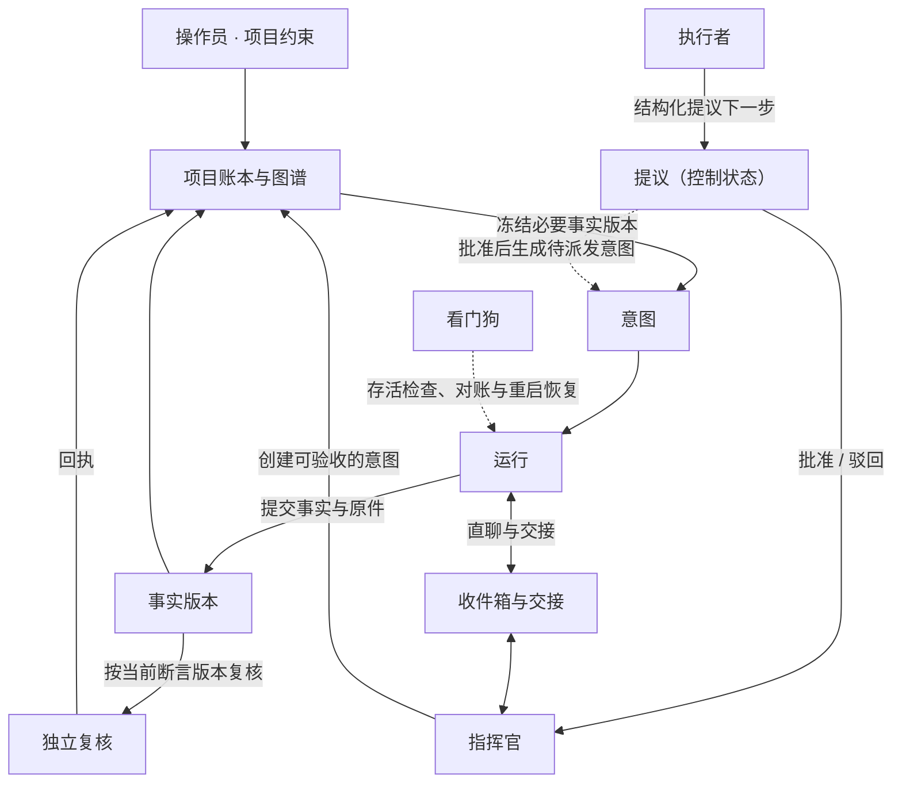
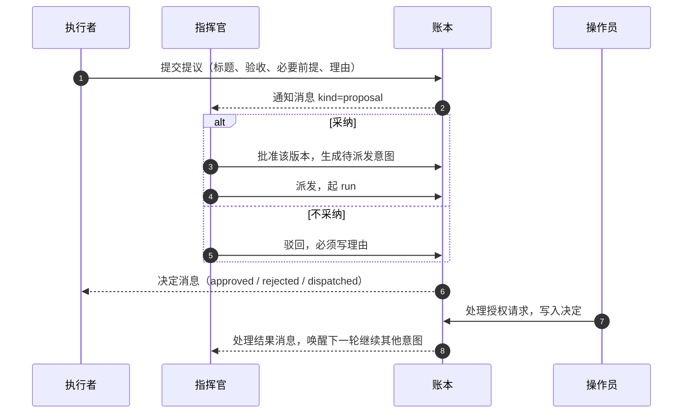

# Saker 核心架构

Saker 是单用户、单实例、多项目的授权安全测试平台。Go 控制面维护项目、账本、会话和运行状态。Web 控制台提供操作、观察与报告入口。Hub 连接 scan 节点，scan 承载模型会话及工具。构建、门禁与协议同步见[贡献说明](../CONTRIBUTING.md)。

## 1. 系统边界

操作员定义起点、终点与内置约束，控制项目启停及工具审批。指挥官读取项目文档、账本与未决事项，登记可独立验收的意图。执行者按意图工作，通过收件箱直接沟通，并提交事实和原始证据。看门狗负责存活检查、取消失联运行、账本对账，并在控制面重启后自动恢复因重启暂停的项目。复核及报告使用各自的辅助运行，运行状态与证据结论分开记录。

### 1.1 事实与意图的运行模型

新意图由指挥官或操作员经 `POST /api/intents` 登记，显式派发后才认领。执行者可以自主决定下一步做什么；需要以新意图开展时，用 `POST /api/proposals` 提交结构化提议（标题、说明、验收标准、必要前提与理由），提议与否、提哪一步由执行者判断，不是必经流程。批准、驳回与派发是三个独立步骤：批准只生成待派发意图，派发才起 run，每一步都有版本与回执。事实通过 `from_fact_ids` 支撑意图，运行写回事实和证据。必要前提在认领时冻结断言版本。普通引用与置顶只提供阅读上下文。外部动作和人工操作可登记等待，完成回执只表示该条件已经得到处理。

## 2. 持续指令与消息

| 内容 | 接收者 | 生效方式 |
| --- | --- | --- |
| 一次性建议或项目取舍 | 默认发给指挥官 | 保存为消息，按投递与已读状态追踪 |
| 当前意图需要知道的提示 | 对应执行者 | 使用定向消息，适合立即告知的单次更正 |
| 持续指令 | 指挥官 | 版本化保存偏好、待办和提醒，可关联意图、修改或撤销 |

约束和授权来自项目的起点、终点、内置约束文档，以及操作员启用的审批模型与 JEV 裁定。持续指令只用于沟通。执行者从项目文档、本轮任务书和有关回执取得工作所需的信息。需要立即停下时，使用暂停或停止动作。

操作员请求只登记为收件箱待办，不暂停项目或指挥官：指挥官发出请求后继续推进其它可推进的意图，某条意图或资产被停只关闭那一条。操作员处理后，决议以消息回到指挥官，由它按项目约束判断是否够用；请求本身不构成授权。

指挥官的终点修改需要操作员发给它的明确消息作为依据。消息与证据正文按输入数据处理，项目约束与审批权限由操作员管理。

## 3. 账本和证据

| 项目用语 | 含义 |
| --- | --- |
| 意图 | 可独立验收的一项工作 |
| 事实 | 有稳定 ID、断言版本和来源引用的记录 |
| 线索 | 需要进一步验证的观察或判断 |

每个项目的 SQLite 账本保存意图、运行、断言、证据、回执、消息、提议、笔记和项目文档修订。起点与内置约束在首次编辑前读取项目清单，编辑后读取账本中的当前版本。工作区保存原件和会话材料。意图按独立可验收的结果划分，同一意图同一时刻只有一个认领。认领和创建 run 行在同一事务中完成。

外部动作登记幂等键与收据。同一动作的重复结论（状态与结果文本都相同）按成功吸收：不新增版本、不重复唤醒等待，也不记成冲突；不同结果、已完成后重置、非当前运行的写入仍然冲突。

提议是控制状态，不是第四种账本实体：它记录谁建议了哪一步、谁在哪个版本上批准或驳回、批准产生了哪个意图、由哪一步派发起了哪个 run。批准与待派发意图在同一事务中落库，因此不存在“已批准却没有意图”的中间态。

断言使用稳定 ID 和断言版本。更正产生新版本，撤回保留原记录和理由。证据原件关联来源和摘要。消息只负责沟通，报告结论从账本与原件取得。世界知识作为有来源的参考，当前项目的判断以本项目证据为准。

## 4. 运行与恢复

派发检查项目状态、宿主、并发和必要前提。启动对账恢复消息与交接，收敛上个进程遗留的运行，并只修复仍指向该运行的意图。运行取消已入账而意图更新失败时，下次对账从已记录的取消继续。登记的等待条件、暂停和停止决定保留。对账失败在项目状态显示失败环节和记录 ID，项目保持暂停。控制台「继续」可重新执行对账，成功后才允许恢复。启动时只自动恢复因重启暂停的项目。外部动作的结果未知时保留未知状态。

进程退出由部署环境的服务管理器或进程监督器确认，使用部署配置的启动命令、工作目录和数据目录恢复。外部看护脚本只读取项目状态并记录观察结果。API 不可达时记录状态无法核实。

看门狗记录巡检开始和完成时间。控制台分别统计守卫取消与自动重派。守卫取消来自已取消的运行，自动重派来自带原运行 ID 的后继记录，跳过或启动失败显示记录的原因。控制台从宿主进程或节点连接读取在线状态，从 harness 工具调用及结束回执读取运行信号，从账本读取意图的事实数量。缺少观测时显示未知，静默取消记录实际静默时长和阈值。

连续六个计入的决策轮没有新增事实、首次有效的当前断言核验或意图完成时，决策日志提示一次。超时轮和交接轮不计入。新开、失败、复核未通过和停放的意图只计入告警所列变化。计数与告警状态随账本保存。

恢复动作有两个预算：按意图的自动续跑次数，以及按共享依赖（网关与节点）的恢复频率。后者限制的是资源而不是工作——同一个网关或节点整体坏掉时，N 条意图各自用满自己的次数，仍会对已经不可用的链路发出 N 倍请求。依赖闸满时该意图不自动续跑，交回指挥官决定；某个依赖上有运行完成即清空该依赖的记录。

## 5. 会话与交接

| 约定 | 指挥官 | 执行者 |
| --- | --- | --- |
| 交接何时发生 | 长会话进入上下文压力周期 | 原意图请求更换会话或接班 |
| 持久载体 | 账本中的版本化项目笔记及本轮写入回执 | 原意图上的版本化交接快照 |
| 带走的内容 | 当前判断、未决事项、事实版本引用 | 已归档的任务书、事实和原件引用、尝试与停止原因、等待条件、消息游标 |
| 接手如何开始 | 收到有效回执后，新会话读取笔记、账本视图和当前项目约束 | 版本校验成功后停止旧 run，保存快照，在同一意图上启动新 run |

指挥官笔记通过当前 run 和读到的版本提交。有效交接会在当前控制面进程内安排下一轮使用新会话，缺少回执时保留原因。笔记里变更或失效的事实引用提示重读。执行者交接在改动旧运行前检查预期版本、认领状态和原任务书归档。交接入账后，接班失败也可保留快照用于恢复。事实引用按当时的记录版本和断言版本冻结。两类接班均按当前项目文档继续。

## 6. 收件箱与协调

同项目执行者可以直聊、请求人工操作、通知交接，并共享事实引用。执行者不能直接创建意图，但可以自主判断下一步做什么：值得独立开展、又不属于当前意图剩余范围的工作，可以选择（不是必须）用结构化提议提交给指挥官或操作员，提议带标题、说明、验收标准、必要前提与理由。完成当前意图、把结果落成事实同样是合格结果，提议不是每轮的产出要求。指挥官或操作员批准或驳回；批准只在账本中生成一个待派发意图，派发是独立一步，起跑仍走同一派发闸。提议的提交、决定与派发各自留下版本与回执，通知只是提醒，状态以账本当前版本为准；控制台通信页可查看并处理待批与待派发提议。指挥官接收明确发给它的请求、项目事件与未决事项。看门狗和协调器根据持久状态运行，消息投递、已读与事实核验使用独立回执。

提议链与授权请求都不阻塞其他意图的派发：指挥官在等待决定期间继续推进可推进的工作，操作员的处理结果以消息回到下一轮；只有整个项目都无法推进时才请求停止。

## 7. 宿主与模型

Hub、scan 和控制面的分工由当前构建的协议契约确定。节点由项目绑定，运行归属记录实际节点，会话续接回到原节点。控制面记录用量和观测数据，harness 负责模型上下文与工具。构建与协议同步见[贡献说明](../CONTRIBUTING.md)。

## 8. 复核与报告

开启复核时，必要事实前提须当前断言通过独立核验。关闭复核时，符合类别要求的未核验断言按原状态展示并可作前提。撤回、否决及不可用作必要前提的线索仍不能承载必要前提。两种模式都记录真实状态。

复核回执绑定断言版本。断言或必要前提失效会使相应背书失效。操作员发起报告后收到运行 ID，可在控制台查询生成与交付状态。报告使用账本快照、项目文档和原件。已复核结论引用当前断言的回执，未复核结论作为候选项，关闭复核时记录对应状态。

## 9. 兼容与验证边界

当前账本采用新版本，不提供原地迁移：旧版项目账本保留在原目录供归档，新版本使用新的数据目录或新建项目。旧项目包按同一版本规则检查，版本不符时拒绝导入。运行中的项目和原始证据由操作员安排备份。

本地测试覆盖账本事务、前提、消息回执、交接与控制台渲染。宿主间协议、跨机运行和实际工具行为需要相应环境验证。项目目录隔离状态与证据，部署的进程和网络边界由运行环境提供。
