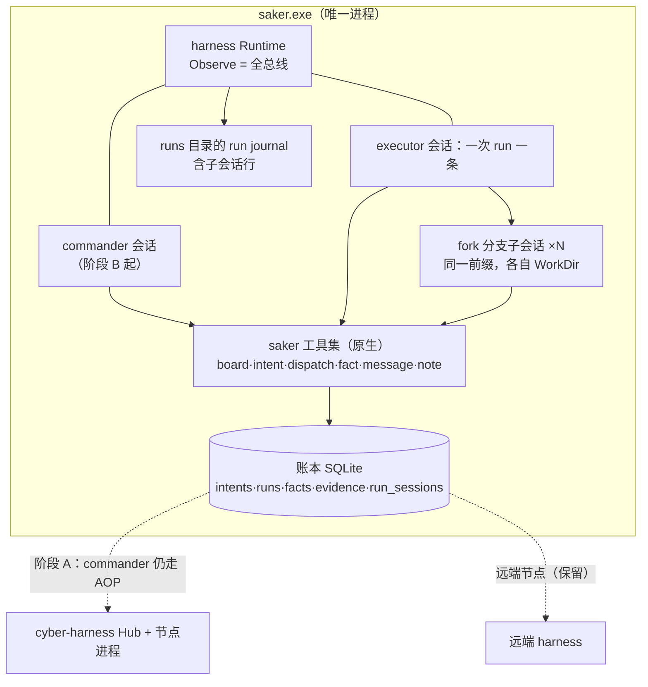

# 嵌入式运行架构（02）

本文是**开发文档**：目标形态、归属模型、落地顺序与验收。`docs/01-architecture.md` 仍是**当前实现**的
事实来源，本文与它冲突时，现状以 01 为准，方向以本文为准。每节标题后的标记表示该节是否已有实现：

- `[现状]` 今天就是这样，改代码不需要动它。
- `[未实现]` 还没有，按 §9 的顺序落地。
- `[已实现]` 落地后回写标记；全部落地后按本文重写 01，并删除本文的计划性内容。

## 0. 摘要与决策

要做的：把 harness 整棵树作为子模块编进 saker，本地执行改在进程内跑；账本、认领、交接、看门狗仍在
saker 的 Go 代码里。

| 决策 | 取值 | 落点 |
| --- | --- | --- |
| 嵌入范围 | 本地全进程内；远端节点保留 AOP | §3、§9 |
| 权限 | 指挥官与执行者同工具面，差异只在 system prompt 与工作目录 | §3 |
| 编排 | 调度权留在 decider（门在账本前），投递走会话 Inbox；派发打账本事务，不把意图做成 subagent | §3 |
| 成本 | 不设 token 上限闸，只逐会话记账 | §2、§6.2 |
| 自持副本 | git submodule + 构建前 pin 校验 | §14 |

**为什么嵌入**：不是「不嵌入没法 fork」，而是 fork 的分支要能被看见、算清、追溯（§1）。这三件事共用
一条链：分支事件要同总线 → 执行者与账本同进程 → 扫描工具集编进 saker。

**先做什么**：阶段 A 只加分——执行者先进进程、开 fork、事实带来源，commander 与 Hub 不动；拿到收益后
再删进程与 AOP（§9）。

---

## 1. 为什么嵌入

嵌入买的是三样，而且这三样在同一条链上：

| 要的东西 | 为什么只有同进程能给 | 今天的断点 |
| --- | --- | --- |
| **看得见** | `Runtime.Observe` 是全运行时事件总线，父会话与 fork 子会话的事件在同一条流上 | AOP 的 `WatchEvents` 按单个 session 订阅（`pkg/web/api/session.go:654`），`belongsToTurn` 会把 session 不匹配的事件丢掉（`internal/aopexec/executor.go:338-345`） |
| **算得清** | 每个子会话有自己的 `turn_ended.usage` 和自己的 `session_id`，可以逐会话记账 | 子会话用量落不进总账，三条分支的 token 是黑箱 |
| **追得到** | 事实在工具调用里声明，`ctx` 带 session/turn/call 身份，来源可以结构化 | 三条分支并发 append `.saker/facts.jsonl`，只有行序，没有身份 |

目标链是硬的：三条路径并行且每条要完整现场 → 必须 fork → 分支要进账本 → 事件必须同总线 →
执行者必须与账本同进程 → 扫描工具集必须编进 saker。中间路线（执行者留节点、saker 另订阅子会话）
技术上成立，但要把可见性建在「从 `Started subagent … (session=xxx)` 里抠 id」或
「轮询 `ListSessions` 找 `parent_session_id`」上，比嵌入脏，而且是长期维护成本。

**代价（实测，2026-11-27）**

| 指标 | 今天 | 嵌入后 |
| --- | --- | --- |
| saker 构建包数 | 317（非标准库 102） | 再叠加 `pkg/harness` 463（非标准库 230）；装扫描工具集时 `cmd/cyber-scan` 入口 1756（非标准库 1487） |
| 依赖 | `go.sum` 58 行、约 20 个 require | 1744 行、354 个 require |
| 二进制 | `saker.exe` 33.7 MB | 最小嵌入探针 35.4 MB（只装一个工具），再叠加 saker 自身与扫描工具集 |
| 交叉编译 | 纯标准库，一条命令 | **失去**（扫描工具集带 cgo 与平台相关依赖） |

口径：包数与二进制由 `go list -deps` 与实编测得；冷构建时间与 `go test ./...` 时长未测（§13 第 9 条）。

---

## 2. 不变量

1. **账本是唯一真值**。harness 侧持久状态一律为空：不装 `inbox` Router（它只拥有 `inbox_route`，
   拿不到任何工具，承担不了账本决定——`docs/architecture.md:60`；装了就是第二份投递状态；
   若将来要装，`StateDir` 必须为空），不落 `active.sqlite`，不把 subagent 的完成回执当业务事实。
2. **run 的生命周期仍由 `internal/lifecycle` 决定**。子会话不产生 run；派生的分支只属于父 run。
3. **重启对账保持可用**。进程死亡时所有 live run 收敛为 `canceled/restart`
   （`lifecycle.ReconcileAfterRestart`），意图 Hold 保留，由指挥官决定重派。
4. **不设 token 上限闸**。成本靠计量，不靠截断：上限会砍掉正在推进的工作，而且是固定配额。
   防线是时间闸（§8.3）、回合上限与重启对账。
5. **不改账本模型**。意图/事实/线索/复核/证据的语义不动；只加来源字段与一张会话表（§10）。
6. **工具是唯一动作面**。写账本只有一条路径，控制台 handler 与工具调同一个函数。

---

## 3. 目标形态



**角色 = 同一套工具上的不同会话配置**（决策：指挥官与执行者同权限）：

| | 指挥官 | 执行者 |
| --- | --- | --- |
| 会话 | 每项目一条长会话，交接时轮换 | 一次 run 一条；`continue` 复用、`handoff` 换 |
| 工具 | 与执行者完全相同 | 与指挥官完全相同 |
| 差异 | `SystemPrompt`、`WorkDir=<data>/<project>/commander` | `SystemPrompt`（本次意图）、`WorkDir=<case>` |
| 派生 | 不派生执行者（派发是工具 + 账本事务，不是 subagent 调用） | 可用 `fork`/`sync` 派生分支（同一现场分叉） |

派发仍走账本：`intent_dispatch` 工具里完成认领事务与 run 行，再起执行者会话。
**不把「意图」做成 subagent**：subagent 是一次 run 内部的派活方式，不是账本实体（01 §6）。

**唤醒与投递**：调度权仍在 `internal/decider`——暂停、注意力、模型、宿主健康、退避、交接压力这些门
在账本前面，不在 agent 循环里（`internal/decider/runner.go:1041-1130`）。它阶段 B 之后不再拼 prompt、
不再管「一次一轮 AOP 会话」，只决定「什么时候给指挥官投递一条输入」；投递走会话 Inbox
（`Runtime.Deliver`），子代理完成与操作员消息也进同一个 Inbox。删掉的是一轮一次的会话载体，不是这些门。

---

## 4. 装配

组合根在 `internal/hostapp`。副本以 git submodule 形式放在 `third_party/cyber`
（形态、pin 与门禁见 §14）。装配形态仿 `cmd/cyber-scan/profile.go`——该文件是 `package main`，
不能 import，只能复制清单：

```
harness.New(harness.Config{
    Base: harness.BaseConfig{Directory, SkillPaths, Provider, Guardrail, Egress, Logger},
    Extensions: []extension.Extension{
        // 扫描能力（照 cmd/cyber-scan/profile.go 的清单，只取执行需要的）
        // subagent：
        subagentext.New(), subagentext.NewTools(),
        // saker 自有：
        sakertools.New(store, lifecycle, ...),
    },
    Session: &agentsession.Config{PrimarySessionID: "saker"},
})
```

**装**：`subagent`（fork 的入口）、扫描/代理/passive/浏览器、文件与 bash、skills、guardrail、
saker 工具集、`exts/otel`（可选）。

**不装**：`webext`（控制台是 saker 的）、`inboxext`（第二套投递状态）、`tui`、`ioaclient`
（消息走账本），`nodeext`（阶段 B 若保留远端再议）。

**维护代价**：复制装配清单会随上游漂移，而它不在 fork 的补丁 diff 里，漂移时编译不会失败。对策在 §14.6。

---

## 5. 归属模型

三层身份，缺一不可：

| 身份 | 来源 | 用途 |
| --- | --- | --- |
| `run_id` | 账本（`Store.StartIntentRun`） | 一次意图执行 |
| `session_id` | harness（`SessionOptions.ID`），**由 saker 生成并写入账本**：意图 run 用 `<run_id>`，commander 长会话用 `<project>`，fork 分支由 harness 分配后回填 | 一次会话；父会话与每个 fork 分支各一个 |
| `call_id` | harness（`operation.InvocationFromContext`） | 父会话里那次 `subagent` 工具调用 |

父会话 id 由 saker 决定，这样重启后能从账本找回会话与其中断点，而不是从磁盘 marker 猜。

**分支身份 = `label` + `parent_call_id`**。`DelegationDetail` 只带 `agent_id/agent_name/agent_type/
context_mode/run_mode/task`（`proto/types/agent.proto:51-58`），没有 `label`；`label` 是父工具调用的参数，
用 `Subagent` 工具调用记录里的 `label` 与子会话 `session_started.parent_tool_call_id` 连接。

派生关系落成一张表，不改账本既有表（§10）：

```
run_sessions(session_id, run_id, parent_session_id, parent_call_id, agent_name, agent_type,
             context_mode, run_mode, label, state, stop_reason, 用量四列, started_at, ended_at)
```

子会话 `state=closed` 时父 run 不一定结束（父轮可能还在等其它分支）；父 run 结算只认账本，
不认子会话状态。

---

## 6. 三条链路

### 6.1 看得见 `[未实现]`

1. `Runtime.Observe` 装一个观察器，把**所有** `*aop.Event` 交给 journal 写入器（今天只有一个
   `runs/<id>.jsonl` 写入器，输入来自 AOP 单会话流）。
2. 归属：`session_id == run.session_id` → 父行；`parent_session_id` 指向父会话 → 子行，`parent_call_id`
   从 `session_started` 取。`event.session_id` 为空的事件按今天的规则归当前 run。
3. journal 行加**可选**字段 `parent_session_id`、`branch`（label）。**不升 schema 版本**：新增可选字段
   不改变既有字段的含义，`V=1` 的旧日志仍然可读；只有字段含义变化时才升版并拒读旧日志
   （`internal/executor/executor.go:24-29`）。
4. 子会话的 `tool_call` / `tool_result` 也进 journal：三条分支各自跑了什么，与父 run 同一条时间线。

### 6.2 算得清 `[未实现]`

- 每个 `turn_ended` 的 `usage` 落到 `run_sessions` 对应行；`usage_missing`/`usage_requests` 一并落，
  缺报不补零（沿用今天的口径：`internal/aopexec/executor.go:577-601`）。
- 父 run 的 `Result.Tokens` 只统计父会话；`run_sessions` 的和才是这次 run 的真实开销。
  控制台在 run 详情里同时显示「父会话」与「分支小计」。
- **不设上限**。不做 `TokenBudget` 闸；`budget` 停止原因保留，但不会因为配额触发。
- **要改写一条旧立场**：`internal/api/journal.go` 的 `nativeSubagentInfo` 写着「临时助手归父会话管理，
  Saker 账本不单独登记其 run/usage 或取消」，`Run.NativeSubagentCalls/Active/DurationMS` 也只按工具名
  计数。子会话仍然不产生 run，但用量要按会话登记——文案与计数一起改成「不产生 run，登记会话与用量」。

### 6.3 追得到 `[未实现]`

工具拿执行身份：

```
cfg, ok := agent.ToolAgentConfig(ctx)        // SessionID / TurnID / ParentSessionID
inv := operation.InvocationFromContext(ctx)  // CallID
```

现状已经有一半：`Fact.SourceRunID` 已在用，`DeclarationID` 目前**默认取 facts.jsonl 的字节区间**
（`internal/model` 的 Fact 注释），这是「由文件位置定义观察身份」。原生工具之后它必须换成
工具调用的稳定身份（`call_id`，或 `session_id + call_id`），否则丢掉 JSONL 就丢了幂等键。

新增两个 **bookkeeping** 字段 `SourceSessionID`、`SourceCallID`。它们**不进 claim 指纹**：
`claimHash` 只序列化一个显式字段结构（`internal/store` 的 `claimHash`，字段顺序即哈希契约），
所以加来源字段不会把所有事实的断言版本推高、不会让既有复核失效。既有测试
`TestClaimHashCoversTheAssertionNotTheBookkeeping` 要扩一条：来源字段变化不改变指纹。

**阶段 A 先验证一件事**：工具 `ctx` 里的 `agent.Config` 是否真的带 `SessionID`/`ParentSessionID`
（`agent/tool_context.go:7-23` 只保证带的是本次执行的 Config）。不带就退化为「由工具自己从
`Operation.InvocationFromContext` 取 call_id，再用 call_id 反查 `run_sessions`」，不猜。

---

## 7. 复用清单

分四类。「何时用」指 §9 的阶段；没有阶段的表示与嵌入无关或明确不用。

### 7.1 已在用，可以吃更深

| 机制 | 现状 | 建议 |
| --- | --- | --- |
| AOP 事件 oneof 与 `Kind*` | 一一对应（`internal/executor/executor.go:31-62`） | 已对齐，保持 |
| typed 扩展 `CompactDetail`/`EvalDetail`/`BudgetWarning`/`DelegationDetail`/`LLMRequestDetail`（`proto/types/agent.proto:39,51,60,68,73`） | `rawJSON` 主动丢弃 `Extensions`（`internal/aopexec/executor.go:821-823`），压缩靠 `IsCompactionState` 匹配字符串 | 阶段 A：嵌入式实现直接读 typed payload，删字符串判定 |
| `usage.detail`（`cache_read`/`cache_write`/`requests`/`usage_missing`/`context_window`） | 已在读（`executor.go:800-811`） | 阶段 A：`context_window` 作唯一来源，删 128000 兜底 |
| Goal Evaluation（`EvalCriteria`/`EvalRounds`，`pass/continue/reason/feedback`，上限 20） | 只在意图显式设 `Eval` 时传 | 建议：意图的验收标准默认作为 eval 标准传入；它只做运行内自查，不替代复核回执 |
| Guardrail 判定 | 读 `Decision`/`Review` 事件；控制台只改 YAML | 阶段 B：用 `Pending`/`Resolve` 闭环 |
| Skills | 物化到磁盘 + 绝对路径 + `/skill:` 前缀 | 阶段 B：改 `skills.Bundle` 贡献，删物化与前缀 |
| 流量事件（`traffic.Flow` → `Kind:"http"`） | 已在用（`executor.go:655-675`） | 出口与 CA 交给 `egress.Endpoint`/proxy 扩展，saker 只读 |

### 7.2 关着或没用

| 机制 | 现状 | 何时用 |
| --- | --- | --- |
| `subagent` sync/async/fork | 默认关（`CYBER_EXCLUDE_TOOLS`，`internal/host/host.go:82-87`） | 阶段 A：嵌入式执行者默认开 |
| `SessionOptions.OnClosed`/`Attached`/`SingleTask` | 没用（`SingleTask` 上游已有字段） | 阶段 A：run 结算与父子生命周期挂这里 |
| `Runtime.Deliver`/`Session.Deliver` | 走 IOA HTTP（`internal/ioa/client.go:139-169`） | 阶段 B：直投 |
| `agent.RunTask` | 没用 | 阶段 B：复核/报告一次性运行 |
| `prompt.Contribution`/`prompt.Resolver` | Go 拼字符串 + 锚点 | 阶段 B：稳定段进贡献 |
| `hooks.ModelPolicy{DisableTools,Purpose}` | 没用 | 阶段 B：给压缩/评估/judge 打标，用量归因更干净 |
| `operation.InvocationFromContext` | 没用 | 阶段 A：工具里拿 `CallID`（§6.3） |
| `MaxParallelTools`/`MaxResultSize`/`CacheRetention`/`Compaction` | 没用 | 阶段 B：按角色调 |
| `mcp` 扩展 | 没用 | 本方案不需要；执行者若仍在外进程才考虑 |
| `exts/otel` | 自有 `internal/metrics` | 阶段 C：模型/工具 span 交给它 |
| `TokenBudget`/`stop_reason=budget` | 没有预算闸 | **不采用**（§2 第 4 条） |

### 7.3 重复实现，应让位

- `modelContext()` 的 128000 窗口兜底（`cmd/saker/hub.go:861-868`）；
- 两份 `absorb` 与两份 delta 折叠（`internal/aopexec/executor.go:543-622` 与
  `internal/executor/process.go:193-234`）；
- skills 物化；
- `internal/metrics` 与 `exts/otel` 各一套观测；
- `internal/executor/session.go`（旧 stream-json 切片合并，无生产调用方）；
- 进程监管（嵌入后整层消失）。

### 7.4 明确不采用

| 机制 | 为什么 |
| --- | --- |
| inbox Router | 只拥有 `inbox_route`，当不了指挥官；再加就是第二套投递状态 |
| `verify`/`sniper` 做复核 | 复核不能由被复核会话派生 |
| IOA outbox 当业务真值 | 内置 IOA 是内存存储，重启重建（`docs/user/web.md:19`） |
| fork 当交接 | fork 是并行分叉，不是换人 |
| token 上限闸 | 固定配额会砍断正在推进的工作（§2 第 4 条） |

---

## 8. 边界

### 8.1 崩溃 `[必须保持]`

- 工具 panic：harness 把 panic 转成工具结果交回模型（`docs/architecture.md:56`）。加一条测试锁住这个前提。
- 进程崩溃 / OOM：整个控制面一起死。防线只有重启对账——`ReconcileAfterRestart` 把 live run 收敛为
  `canceled/restart`（`internal/lifecycle/lifecycle.go:792-842`），**子会话行也要一起收敛**，
  不能留下 `state=open` 的孤儿行。这条要有测试（§11）。
- 子进程：bash/PTY 由 harness 的 `proc.Manager` 管，取消会话时停掉；saker 崩溃时它们可能成为孤儿。
  阶段 B 需要一条「按账本里 live run 的 case 目录清扫遗留进程」的检查，或依赖 Job Object。

### 8.2 取消 `[未实现]`

`ctx` 取消 → `Runtime.CancelSessionRun(sessionID, turnID)`；父会话关闭会取消并等待子会话
（`docs/architecture.md:96`）。停止项目 = 取消该项目的全部 live run 及其子会话。
终态仍由 lifecycle 落：`SettleIntentForRun` 的入参不变。

### 8.3 时间 `[未实现]`

每次 run 必须有 deadline：取项目级 `run_timeout`，其次取实例 `--timeout`。两者都为 0 时
**不伪造默认值**：run 行记录「未设时间闸」并在控制台显示，同时照常执行。

---

## 9. 落地顺序

### 阶段 A：子会话可见 + 原生事实工具（只加分，不改现有路径）

范围：`third_party/cyber` submodule + `UPSTREAM` + 构建前三项门禁（§14.3）、`internal/hostapp`（装配）、
`internal/hostrunner`（`executor.Executor` 的进程内实现，只接 `Purpose == ""` 的意图 run）、
`internal/tools/ledger` 的 `fact_submit`/`evidence_attach`、`run_sessions` 表、journal 子会话行。

不动：commander 仍走 AOP；Hub 与节点进程照旧；HTTP 动作面照旧。

验收场景固定为你的目标场景：主线已经积累代理配置、账号与拓扑，**同一现场同时试越权 / 提权 /
数据外带三条互不依赖的路径**。三个具名 fork 定义，同一段 system prompt，各自 `WorkDir` 与验收，
`DefaultMode: fork`；三条分支从同一前缀起跑，父轮等它们回来后才结束。

行为对等项（不能比 `aopexec` 少）：媒体与 artifact 落盘、usage 聚合（含缺报）、取消、
续跑、`belongsToTurn` 的等价规则（改成「按会话归属」而不是「按单一 session 过滤」）。

退出标准：

1. 一次真实意图 run 里，三条 fork 分支在 `runs/<id>.jsonl` 中各有一组行，`run_sessions` 三行 + 父行。
2. 每个子会话的 `turn_ended.usage` 落库，缺口计入 `usage_missing`，不补零。
3. `fact_submit` 写的事实带 `(source_session_id, source_call_id)`，能查到是哪条分支。
4. 工具 panic 不带走进程。
5. `kill` 进程后重启：live run 与子会话全部 `canceled/restart`，无 `state=open` 残留。
6. 远端节点与 commander 的 AOP 测试仍全过。

回滚：`--runtime=embedded|aop` 开关；默认先 `aop`，逐项目打开。

### 阶段 B：切主路径、删本地进程

范围：commander 进进程；`purpose` 全部走嵌入式（远端节点除外）；删本地 AOP 路径——`internal/host`
的本地进程监管、`internal/aopexec` 的 marker/游标、`cmd/saker/session_env.go`、会话令牌与
「路由可见性即权限」、`/skill:commander` 前缀与 prompt 锚点；事实改为声明时入账。

退出标准：一次真实项目的完整流程（派发 → 执行 → 事实 → 复核 → 报告）全进程内；远端节点仍可用；
续跑/取消/交接/插话四条各有复现测试。

### 阶段 C：收口

- 协议改 import：删 `internal/aop/{pb,pty,traffic,tool,command,operation,guardrail}` 下的生成副本，
  改 import 副本模块的 `aop/...`；`internal/buildinfo/aopproto.go` 的 drift gate 与
  `cmd/saker-gate -check-aop-protos` 同时删除（同一份协议不再有两个来源）。
- 文档与声明：按本文重写 01、更新 `NOTICE`（嵌入来源、commit、AGPL、补丁清单位置）、
  更新 `UPSTREAM`（`base`/`commit`/`synced`）。
- 删死代码：`internal/executor/session.go`（旧 stream-json 切片合并，无生产调用方）、
  `internal/host` 的本地进程监管。
- 补齐 `Transport = embedded|aop|audit`。

---

## 10. 数据模型增量

账本不是「一实体一张表」，而是 `objects(kind,id,version,payload)` + `versions` + `relations` 的文档存储
（`internal/store/sqlite.go` 的 `CREATE TABLE` 清单）。因此：

- **会话归属与用量**新增一张表（`run_sessions`），与会话生命周期同事务写入；
- **事实来源**是两个 payload 字段，不是 `ALTER TABLE`。

```sql
-- 会话归属与用量；run_id 外键指向账本既有 runs
CREATE TABLE run_sessions (
  session_id        TEXT PRIMARY KEY,
  run_id            TEXT NOT NULL,
  parent_session_id TEXT NOT NULL DEFAULT '',
  parent_call_id    TEXT NOT NULL DEFAULT '',
  agent_name        TEXT NOT NULL DEFAULT '',
  agent_type        TEXT NOT NULL DEFAULT '',
  context_mode      TEXT NOT NULL DEFAULT '',  -- fork / fresh
  run_mode          TEXT NOT NULL DEFAULT '',  -- background / foreground
  label             TEXT NOT NULL DEFAULT '',
  state             TEXT NOT NULL,             -- open / closed
  stop_reason       TEXT NOT NULL DEFAULT '',
  tokens            INTEGER NOT NULL DEFAULT 0,
  input_tokens      INTEGER NOT NULL DEFAULT 0,
  output_tokens     INTEGER NOT NULL DEFAULT 0,
  cached_input_tokens INTEGER NOT NULL DEFAULT 0,
  usage_requests    INTEGER NOT NULL DEFAULT 0,
  usage_missing     INTEGER NOT NULL DEFAULT 0,
  started_at        TEXT NOT NULL,
  ended_at          TEXT NOT NULL DEFAULT ''
);
```

事实来源改为 `model.Fact` 的两个 bookkeeping 字段（payload 内，可选，不进 claim 指纹）：

```
SourceSessionID string `json:"source_session_id,omitempty"`
SourceCallID    string `json:"source_call_id,omitempty"`
```

`DeclarationID` 的取值同时换掉：从「facts.jsonl 字节区间」换成工具调用的稳定身份，
否则声明幂等依赖的是文件位置而不是调用身份。

journal 只加可选字段，不升 `JournalSchemaVersion`（理由见 §6.1）。

---

## 11. 测试矩阵

每条都要能复现失败原因，注释写清边界（`AGENTS.md` §3）。

| 测试 | 断言 | 失败原因 | 边界 |
| --- | --- | --- | --- |
| `TestForkChildrenVisibleOnRuntimeBus` | 三条 fork 的 `session_started`/`turn_ended` 出现在同一 `Observe`，归到父 run | 订阅按 session 过滤时会只看到父会话 | 子会话 `state=open` 期间也要可见 |
| `TestChildUsageAccountedPerSession` | 三个 `run_sessions` 行各有用量，和不超过 Provider 账单 | 只在父 `turn_ended` 记账会漏 | 缺报计 `usage_missing`，不补零 |
| `TestFactSourceAttribution` | 三个分支各写一条事实，来源字段不同 | 并发 append 同一 JSONL 时无法区分 | 同一分支重复写，`call_id` 不变 |
| `TestToolPanicBecomesResult` | 工具 panic → `is_error` 结果，进程存活 | 无 recover 时整进程死 | panic 在工具 goroutine 内 |
| `TestRestartReconcilesChildSessions` | 杀进程重启后，子会话 `state=closed` + 父 run `canceled/restart` | 只收敛父 run 会留孤儿 | 重启发生在子会话运行中 |
| `TestCancelParentStopsChildren` | 取消父 run 后子会话停止并落终态 | 子会话逃出取消范围 | fork/async 两种 |
| `TestDeliverInjectsIntoRunningTurn` | 插话在下一次模型调用前到达，不打断当前轮 | 直投绕过 mailbox 时会丢消息 | 队列满时的背压 |
| `TestSessionResumeFromTranscript` | 重启后按 `Messages`/`HistorySnapshot` 重建，历史条数与摘要一致 | 不保真就退化为新会话 + 交接快照 | 压缩过的会话 |
| `TestSystemPromptByteStable` | 同进程两次构造的 system prompt 逐字节相等（工具/技能顺序、`Session Started`） | 顺序来自未排序的注册表或换时间戳时，fork 共享前缀失效 | 不同会话、不同分支 WorkDir |
| `TestEmbeddedToolSurface` | 关键工具名齐全（bash/read/edit/subagent/扫描命令） | 上游改名会静默少能力 | 只断言存在，不断言行为 |

---

## 12. 不做

机制层面的「不采用」见 §7.4。这里只列产品级约束：

- 不设 token 上限闸；不因成本截断运行。
- 不改账本语义（只加 §10 的来源字段与会话表）。
- 阶段 A/B 不改 `docs/01-architecture.md`（补正清单见 §15）。
- 不为了嵌入顺手改 harness；能落在扩展点/会话配置/自有工具的，不进副本（§14.4）。

---

## 13. 开工前要逐条验证

1. `agent.ToolAgentConfig(ctx)` 是否带 `SessionID`/`ParentSessionID`（决定 §6.3 的取法）。
2. 子会话 `session_started` 是否带齐 `parent_session_id`/`parent_tool_call_id`/`DelegationDetail`。
3. `Runtime.Observe` 是否也收到子会话的 `message_delta`（决定 journal 是否要折叠子会话 delta）。
4. `harness.New` 与 `Session` 扩展在「先装 base、后加扩展」顺序下的加载错误是否可定位。
5. fork 子会话的 `WorkDir` 是否随具名定义的 `Prepare` 覆盖生效（三条分支不互相踩文件）。
6. `usage.detail.cache_read` 在三条同前缀分支上是否真的非零（缓存复用是推断，不是承诺）。
7. 同一进程内构造两次 system prompt，字节是否相同：工具/技能列表顺序（`ToolDefinitions()`/
   `Skills.All()` 未排序）与 `Session Started`（取 Runtime 创建时间，`agent/session/runtime.go:36,278`）。
   这是 fork 前缀缓存的前提，不成立就不要在文档里写「缓存可复用」。
8. `UPSTREAM.commit` 与 submodule gitlink 不一致时，构建门禁是否真的失败（先写门禁，再造一个不一致验它）。
9. 冷构建时间与 `go test ./...` 时长（嵌入后 1756 包）：从分钟级变十分钟级就先解决测试组织，不接受。

---

## 14. 维护自持副本 `[未实现]`

嵌入不消灭 fork，只改变它的形态与门禁方式。这一节定的是：副本怎么放、pin 怎么验、补丁怎么退、
升级怎么走。

### 14.1 形态：git submodule

| 项 | 取值 |
| --- | --- |
| 位置 | `third_party/cyber/`（saker 仓库内的 submodule） |
| remote / branch | `kksty/cyber-harness` 的 `saker/fixes` |
| 自带的嵌套模块 | `third_party/cyber/aop/`（`github.com/chainreactors/cyber/aop`） |
| saker 的 `go.mod` | `require github.com/chainreactors/cyber v0.0.0` + `replace github.com/chainreactors/cyber => ./third_party/cyber` + `replace github.com/chainreactors/cyber/aop => ./third_party/cyber/aop` |
| 克隆 | `git submodule update --init --recursive`（构建脚本先跑这一句） |

`replace` 到本地目录时，`require` 里的版本号不参与解析，**pin 由 submodule 的 gitlink 决定**；
`UPSTREAM` 只是给人读的副本，门禁以 gitlink 为准。

为什么不是另外两种形态：

| 形态 | pin 是不是 git 事实 | 漂移是否可见 |
| --- | --- | --- |
| submodule | 是（gitlink） | 是（`git status` 直接显示子模块变化） |
| 普通目录提交进仓库 | 不是（靠文件里写的字符串） | 本地顺手改副本看不出来 |
| module cache + `replace ../cyber` | 不是（依赖旁边有没有 checkout） | 换机器/CI 直接编不过 |

### 14.2 `UPSTREAM`（仓库根，saker 所有；不放进 submodule）

放在 submodule 里就等于改副本，所以这份文件由 saker 维护，门禁读它：

```
fork      kksty/cyber-harness
branch    saker/fixes
commit    <sha>            # 与 gitlink 一致；门禁比对这一行
upstream  chainreactors/cyber-harness
base      <sha>            # 最近一次真正合并进来的上游 master
synced    2026-11-27
compose   <blob>           # cmd/cyber-scan/profile.go 在该 commit 的 blob hash（§14.6）
patches   见 FORK.md（条数即债务规模）
```

`base` 必须是 HEAD 的祖先——门禁用 `git merge-base --is-ancestor` 验，防止「记了 base 但没真的 merge」。

### 14.3 构建前三项门禁

1. **pin**：`go run ./cmd/saker-gate -check-fork-pin`
   - submodule 未初始化 → 失败，打印 `git submodule update --init --recursive`；
   - `git -C third_party/cyber rev-parse HEAD` ≠ `UPSTREAM.commit` → 失败并打印两个值；
   - `git -C third_party/cyber status --porcelain` 非空 → 失败（「本地临时改一下」正是漂移来源）；
   - `UPSTREAM.base` 不是 HEAD 的祖先 → 失败。
2. **fork 自身回归**：`go run ./cmd/saker-gate -check-fork-tests`
   - 在 submodule 里跑补丁清单里的包（包名常量放在 saker 侧，每条注明对应 FORK.md 的补丁号），
     不解析 Markdown；这是「fork 的测试不会自动被 `go test ./...` 带到」的补救。
   - 只跑受影响包，单次控制在三分钟内。
3. **工具面**：`TestEmbeddedToolSurface`（§11）+ `-check-embedded-surface`
   - 断言 `bash`/`read`/`edit`/`subagent`/关键扫描命令存在；上游改名会在这里失败，而不是静默少能力。

`cmd/saker-gate -check-aop-protos` 继续保留到阶段 C：那时 `internal/aop/*/*.pb.go` 改为 import 副本模块，
两个协议来源合一，这个 gate 与那批生成文件一起删除。

### 14.4 补丁纪律与退休清单

规则两条：**能用扩展点/会话配置/自有工具解决的，不改 harness**；每个补丁必须有 FORK.md 条目
（原因、回归测试、回滚）并在升级时逐条核对。

| 类别 | 补丁（FORK.md 编号） | 嵌入后的处理 |
| --- | --- | --- |
| 直接退役（理由消失） | #5 `CYBER_EXCLUDE_TOOLS`、#8 `SingleTask` 的 AOP 扩展、#16 关 recap、#13 配置元数据 | 改为「装哪些扩展 + 会话 `Tools`」「`SessionOptions.SingleTask`」「不装 `recapext`」「程序化构造配置」 |
| 核心保留、只是不再需要跨进程载体 | #1 Continue inbox、#3 每会话 `WorkDir`、#15 `EvalGoal` | 字段与语义留着，AOP 扩展的解析删掉（上游仍无这些字段，别误以为能整条删） |
| 与嵌入无关，原样保留 | #2 `context_window`、#4、#6、#7、#9、#10、#12、#17、#18、#19、#20 | 与进程边界无关，照旧同步上游 |

衡量口径不是文件数，而是**补丁条数 + 每条有退役条件**。今天 121 文件 / 7034 插入 / 422 删除是现状，
不是目标；「为嵌入新增的补丁 ≤20 文件、核心 ≤300 行」才是可以承诺的那条线（理想 0–5）。

### 14.5 升级流程

```sh
# 1) 进入副本并同步上游（副本平时是 detached HEAD，升级前先切到维护分支）
git submodule update --init --recursive
cd third_party/cyber
git fetch origin && git fetch upstream
git checkout saker/fixes
git merge upstream/master            # 按 FORK.md 的流程解冲突、逐条核对回归测试
go test ./agent/... ./exts/... ./tools/...   # 受影响包，三分钟内
git push origin saker/fixes
cd ../..

# 2) 在 saker 里提交新的 gitlink、更新 UPSTREAM（commit/base/synced/compose）
git add third_party/cyber UPSTREAM

# 3) 门禁与受影响包测试
go run ./cmd/saker-gate -check-fork-pin
go run ./cmd/saker-gate -check-fork-tests
go run ./cmd/saker-gate -check-embedded-surface
go test ./internal/... ./cmd/saker/...
```

然后跑五条冒烟（**断言**，不是「点一遍」）：

1. 一条意图（含 `fact_submit` → 账本）；
2. 一次 fork（三条分支：子会话可见、逐会话用量、事实来源）；
3. 一次取消 + kill 进程后的重启对账（`canceled/restart`，无 `state=open` 残留）；
4. Windows：bash 外部命令与路径（FORK.md #20 就是被这个咬过的）；
5. 工具面 gate 通过（同 §14.3 第 3 项）。

完整断言见 §11 测试矩阵；这里只列升级时必须人工确认的那几条。

### 14.6 装配清单的漂移（新的维护面）

`cmd/cyber-scan/profile.go` 是 `package main`，只能复制到 `internal/hostapp/compose.go`。它**不在** fork 的
补丁 diff 里：上游新增一个扩展、改一个构造参数，saker 不会编译失败，只会少能力。对策：

- `UPSTREAM.compose` 记该文件在我们 pin 的 commit 上的 blob hash；
  `git -C third_party/cyber rev-parse HEAD:cmd/cyber-scan/profile.go` 必须与它相等；
- 复制体文件头写同一个 hash；两者不等 → 门禁失败 → 人读 `profile.go` 的 diff → 更新复制体与 hash。
- 每次升级都要读一遍 `profile.go` 的变更，这是唯一无法自动化的部分。

### 14.7 许可与声明

`NOTICE` 增加：嵌入来源（`kksty/cyber-harness`）、commit、AGPL-3.0、本地补丁清单位置（FORK.md）、
以及「本仓库内 `third_party/cyber` 是上述项目的副本，不是本仓库重新授权」。01 的 §9 兼容边界在阶段 C
一起改，阶段 A/B 不改 01。

---

## 15. `docs/01-architecture.md` 的补正清单 `[未实现]`

阶段 A/B 不改 01（它仍是现状的唯一事实来源）。这一节存的是「01 现在写错或写漏、且不依赖新代码」的条目，
以及「必须等代码落地才能写」的条目。阶段 C 按本文重写 01 时，B 组一并处理。

### 15.1 现在就能改（事实修正，不依赖新代码）

| 位置 | 现状 | 应改为 |
| --- | --- | --- |
| §10 工具审批 | 只写 provider/mode/scope 的判定规则 | 补三条：`scope` 只按工具名过滤、`allow_prefixes` 只是字面前缀，**都不是安全边界**；`safe` 的 review 今天只能由 harness 侧放行或按 `review_timeout` 过期；审批不跨重启恢复 |
| §7 宿主与模型 | 「harness 负责模型上下文与工具」 | 补：模型名与上下文窗口只以 harness 上报为准（`session_started.model`、`usage.detail.context_window`），控制面不维护窗口表；128000 兜底要删或标注为仅展示 |
| §4 运行与恢复 | 讲账本、对账、预算 | 补：每次 run 另有一份 `runs/<id>.jsonl`，带 schema 版本，读不了拒读；它是事件记录，不是账本 |
| 全文 | 没有「工具面」这一层 | 新增一节：工具面由安装的扩展与会话配置决定；`CYBER_EXCLUDE_TOOLS` 与 `--allow-native-subagent` 是当前的两个开关；子代理属于一次 run 内部 |
| 全文 | 没有「外部运行时与版本」 | 新增一节：harness 是外部依赖，协议来自它的 protobuf；自持副本必须记上游基线 commit 与本地改动清单 |

### 15.2 落地后再写（否则 01 会描述不存在的实现）

- 会话内派生子会话（fork/async）的语义：不产生独立 run、事件归父 run、取消随父、用量按 session 归因。
- 工具面从环境变量换成「装哪些扩展 + 会话 `Tools`」。
- 审批闭环：控制台用 `Pending`/`Resolve` 放行。
- 续跑载体：会话句柄 + 持久 transcript 替代 `.saker/aop-session.json`。
- 上下文与交接：稳定契约进提示词贡献、易变材料进每轮输入。

---

## 参考

**saker（现状）**

- 调度与门：`internal/decider/runner.go:1041-1130`；`internal/decider/decider.go:445-529`
- 执行链路与事件翻译：`internal/aopexec/executor.go:48-336,338-345,543-622,653-795,800-811,821-823`
- 工具面与动作面：`cmd/saker/auth.go:387-423,515-578`；`internal/skills/assets/commander/SKILL.md`
- 账本存储形态：`internal/store/sqlite.go:69-76`；claim 指纹：`internal/store` 的 `claimHash`
- 对账与生命周期：`internal/lifecycle/lifecycle.go:548-604,792-842`
- 现行立场：`internal/api/journal.go` 的 `nativeSubagentInfo`
- 协议副本 gate：`internal/buildinfo/aopproto.go`；`cmd/saker-gate -check-aop-protos`
- 自持副本现状：fork 仓库的 `FORK.md`（`saker/fixes`，44 commits / 121 文件 / 7034 插入 / 422 删除 / 20 条补丁）

**cyber-harness（嵌入侧）**

- 宿主集成：`docs/developer/hosting.md:11-49,85-90`
- 会话与子代理：`docs/architecture.md:44,60,76,92-111,197-222`；`docs/user/web.md:70-87`
- 观察、取消、投递、恢复（源码核实）：`agent/session/session.go:525,846,906,994,1575,37,47`
- 配置与工具：`agent/types.go`（`Config` 字段）、`agent/subagent/registry.go`（`Prepare` 签名）
- 守卫：`exts/guardrail/runtime.go:441,460`；`proto/types/guardrail.proto:36-44`
- 提示词：`exts/prompt/defaults.go`（`RenderEnvironment` 不含工作目录）；`agent/session/runtime.go:36,278`
- 子会话订阅边界：`pkg/web/api/session.go:654`
